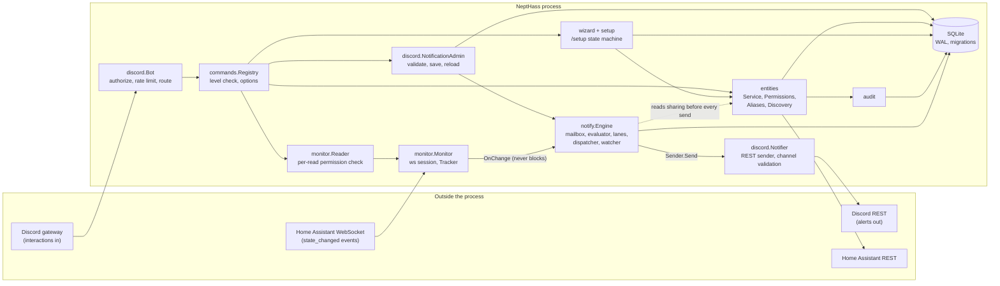
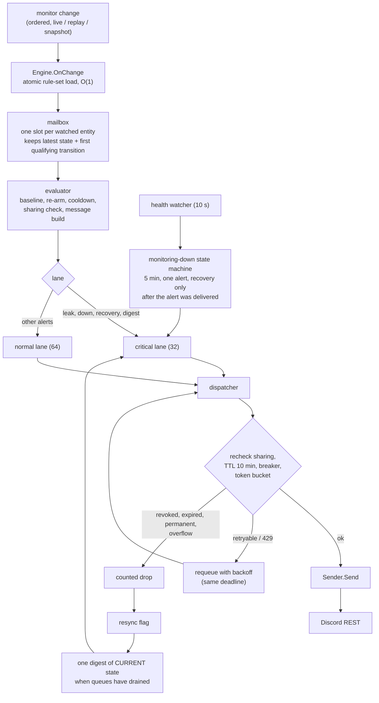

# Architecture

NeptHass is a modular monolith: one Go binary, one SQLite file, no public API. It only makes outbound connections (Discord, Home Assistant) and listens on no port.

This document describes the system as of **v0.4.0**. The per-milestone design records are in [design/](design/): [interactive setup](design/interactive-setup.md), [sensor monitoring](design/sensor-monitoring.md) and [notifications](design/notifications.md).

## System overview



## Package map

```text
cmd/nepthass                  wiring only: config, logger, dependencies, signals, shutdown order
internal/config               environment parsing and validation, Secret type
internal/logging              slog logger with secret scrubbing
internal/storage              SQLite open + migration runner      <- migrations/ (embedded SQL)
internal/auth                 guild/user allowlists, levels, rate limiter
internal/audit                audit log table + retention (usable inside a transaction)
internal/entities             entity model, permissions, aliases, discovery cache, sync registry, Service
internal/setup                setup sessions: state machine, store, plan, atomic apply (Discord-free)
internal/homeassistant/rest   Home Assistant REST client (service allowlist)
internal/homeassistant/ws     Home Assistant WebSocket session: handshake, id correlation, reader, ping
internal/monitor              live monitoring: state machine, backoff, reconciliation, Tracker, change feed, Reader
internal/notify               notification rules, engine (mailbox, evaluator, queues, dispatcher, breaker,
                              monitoring-down state machine); transport-neutral, no Discord imports
internal/discord              gateway session, interaction routing, Notifier (Discord REST sender), channel
                              validation, NotificationAdmin
internal/discord/commands     slash command definitions and replies
internal/discord/wizard       the /setup wizard: panels, custom IDs, click handling
internal/discord/ui           shared embed helpers: branding, escaping, limits
tests/fakeha                  in-memory Home Assistant (REST and a scriptable WebSocket) for unit tests
tests/integration             tests against a real Home Assistant (build tag "integration")
```

Dependency direction: `discord -> {commands, wizard} -> {setup, entities, notify, monitor} -> {auth, audit}`. `notify` depends on `monitor` (types and the change feed), `entities` (permissions) and `auth`, never on Discord. `monitor` knows nothing about Discord or notifications. The rules about who may do what live in `entities` and `setup` and know nothing about Discord. The wizard holds no business rules.

### Interfaces that matter

| Interface | Defined in | Satisfied by | Why it exists |
| --- | --- | --- | --- |
| `notify.Sender` | `internal/notify` | `discord.Notifier` | keeps the engine transport-neutral and testable with fakes |
| `notify.AccessSource` | `internal/notify` | `entities.Permissions` | sharing is re-read before every send |
| `notify.SensorLookup`, `notify.StatusSource` | `internal/notify` | `monitor.Tracker`, `monitor.Monitor` | evaluation and health without importing the monitor's internals |
| `notify.Clock` | `internal/notify` | real clock, fake clocks in tests | deterministic tests of timers, TTL, cooldown and the five-minute outage |
| `monitor.Config.OnChange` | `internal/monitor` | `notify.Engine.OnChange` (via a late-bound hook in `main`) | ordered change feed; must never block |
| `commands.Notifications`, `commands.Monitoring` | `internal/discord/commands` | `discord.NotificationAdmin`, `monitor.Reader` | commands stay free of storage and engine details |
| `entities.HomeAssistant`, `StateSource`, `Recorder` | `internal/entities` | `rest.Client`, `audit.Log` | small interfaces defined where they are used |

## Startup and shutdown

`serve()` in `cmd/nepthass/main.go`:

1. Opens SQLite and applies migrations (`storage.Open`). A database written by a newer build, or a migration whose checksum changed, stops startup.
2. Verifies Home Assistant over REST. An unreachable Home Assistant is a warning (NeptHass keeps running); a rejected token stops the process.
3. Builds the services (`entities`, discovery, `setup`), then the monitor with a late-bound `OnChange` hook, then the notification store, service, Notifier and Engine, then the Discord bot.
4. Binds the Notifier to the bot's session (REST only), runs `engine.Reload` once (notifications stay disabled if no settings exist), and starts three background goroutines: audit retention, the monitor, and the engine (which owns three more).
5. Runs the bot (the gateway) in the foreground.

On SIGTERM or SIGINT the root context is cancelled: the bot closes its session, the monitor closes its WebSocket, and the engine stops its evaluator and watcher and **drains the queue for at most three seconds** over REST (which does not need the gateway). `background.Wait()` joins all of them before the database is released. An intentional shutdown never produces a monitoring-down alert.

## Concurrency model

| Goroutine(s) | Owner | Shared state it touches |
| --- | --- | --- |
| Discord gateway and one goroutine per interaction | discordgo + `Bot.serve` (panic-safe) | rate limiter (mutex), SQLite pool |
| Monitor supervisor, WebSocket reader, pinger | `monitor.Monitor`, `ws.Session` | `Tracker` (mutex), change feed callback |
| Engine evaluator | `notify.Engine` | rule states (owned by this goroutine), mailbox (mutex), queue (mutex) |
| Engine dispatcher (and one short-lived goroutine per send) | `notify.Engine` | queue, breaker (mutex), token bucket (mutex), counters (atomics) |
| Engine health watcher | `notify.Engine` | monitoring-down state machine (mutex), reload retry |
| Audit retention | `audit.Log` | SQLite |

- The rule set is swapped atomically (`atomic.Pointer`), so the monitor's callback does one atomic load and a map lookup. `Reload` is serialized by a mutex.
- SQLite uses WAL, immediate transactions, a 5 second busy timeout and at most 4 connections.
- The monitor emits changes in a strictly increasing sequence, synchronously and in order. The callback contract is "record and return": no database, network or goroutine. This is tested with a Sender that never answers and with the database closed.

## Interaction lifecycle

1. discordgo delivers an `InteractionCreate` event on the gateway.
2. `Bot.serve` calls `handleInteraction`, which first runs `Authorizer.Authorize(guildID, userID)` for **every** interaction type. Rejections get a generic ephemeral message and a WARN log.
3. Commands are rate limited per user (6 per 10 seconds), then acknowledged immediately with a deferred ephemeral response (Discord requires an answer within 3 seconds).
4. `commands.Registry.Run` enforces the command's minimum level, refuses a request containing an option type it cannot parse, and calls the services.
5. The reply is delivered by editing the deferred response. Mentions are disabled on every message.
6. Autocomplete follows the same authorization path and must answer within about 2.5 seconds. `/notifications` autocomplete is administrator-only and reads the same `monitor.Reader` as `/sensors`.
7. Components and modals (the setup wizard) take the same path, with a separate per-user click limit (30 per 10 seconds); the setup service re-checks administrator level and session ownership.

## Authorization layers

| Layer | Where | Rule |
| --- | --- | --- |
| Guild | `auth.Authorizer` | Interaction must come from `DISCORD_GUILD_ID` (DMs rejected) |
| User | `auth.Authorizer` | Admin list, or optional user list; everyone else rejected |
| Command level | `commands.Registry`, services | `/permissions`, `/audit`, `/setup`, `/sync` and `/notifications` need administrator level, checked at the gate and again in the service |
| Setup session | `setup.Service` | Every wizard operation requires administrator level and a session owned by the caller |
| Entity | `entities.Permissions` | No row means no access, even for administrators |
| Domain | `entities.Domain.Controllable`, `rest.allowedServices` | Only `light` and `switch` can be controlled |
| Live data | `monitor.Reader` | Re-checks level and current permission on every read; the cache grants nothing |
| Notifications | `notify.Engine`, `notify.Service` | Sharing is read before an alert is produced and before every delivery attempt; configuration is administrator-only |

Discord roles and channel permissions play no part in *who may use commands*. They matter in one place: when an administrator chooses the alert channel, NeptHass checks that it is a text channel of the configured guild and that the **bot** can view it, send messages and embed links.

## Home Assistant integration

- **REST** is authoritative for commands: one request per use, redirects never followed, a service allowlist inside the client. It never depends on the WebSocket, so commands keep working while monitoring is down.
- **WebSocket** feeds live state: one session, `subscribe_events` for `state_changed`, buffered events replayed after an authoritative `get_states` snapshot on every (re)connect, health reported as five separate facts. Home Assistant does not replay missed events; NeptHass never invents them and finds what changed while disconnected through the snapshot. Details: [design/sensor-monitoring.md](design/sensor-monitoring.md).
- `Tracker` keeps the latest state of every classified `sensor` and `binary_sensor` in memory only (nothing is written to SQLite).

## Entities, sharing, permissions and aliases

`entities.Permissions` is the allowlist (`read` or `control` per entity, nothing means no access). `entities.Discovery` keeps one immutable snapshot of compact items (30 second reuse). `/sync` records known entity IDs to report new, removed and returned entities; names and states are never stored. Aliases are stored by canonical ID and resolved only to an entity the caller already has access to. `/setup` writes the same permission table through one atomic transaction with audit entries, and a session is a JSON draft saved with a compare-and-swap on a version counter, so two clicks cannot both win and a replay writes nothing. Details: [design/interactive-setup.md](design/interactive-setup.md).

## Notification pipeline



What the pipeline guarantees and what it does not (best-effort delivery with bounded staleness and possible duplicates, no persisted outbox, first observation silent, cooldown semantics) is specified in [design/notifications.md](design/notifications.md); it is not repeated here so there is one source of truth.

## Data model (SQLite)

Migrations are embedded from `migrations/`, applied in order inside transactions, and recorded in `schema_migrations` with a SHA-256 checksum. Startup refuses a database written by a newer build and refuses a migration whose checksum changed. Never edit a released migration; add a new one.

| Table | Purpose |
| --- | --- |
| `entity_permissions` | entity ID, `read`/`control`, who granted it, when |
| `command_audit_logs` | control attempts, permission and notification changes with outcome |
| `entity_aliases` | canonical entity ID to alias, unique case-insensitively (v0.2.0) |
| `setup_sessions` | persisted wizard sessions: JSON draft, step, status, version, expiry (v0.2.0) |
| `known_entities` | minimal `/sync` registry: entity ID, domain, first/last seen, missing since (v0.2.0) |
| `notification_settings` | per guild: alert channel and enabled flag; no row means disabled (v0.4.0) |
| `notification_rules` | one row per rule, at most 200, unique per entity and kind (v0.4.0) |
| `schema_migrations` | applied migrations and checksums |

Each package owns the SQL for its own tables. Timestamps are fixed-width UTC text so they sort chronologically. The database runs in WAL mode with foreign keys on; the file is created with owner-only permissions. There is deliberately **no outbox table**: pending notifications live in memory only. Migrations 0002 and 0003 only add tables, so older databases upgrade in place, but an older binary refuses an upgraded database, so a downgrade means restoring a backup.

## Failure boundaries

| Failure | Contained by | Result |
| --- | --- | --- |
| Discord gateway drops | discordgo reconnect and resume | commands pause; alerts keep flowing over REST |
| Discord REST slow, failing or rate limited | dispatcher: backoff, `retry_after`, breaker, TTL | monitoring and commands are unaffected; losses are counted and reconciled by a digest |
| Alert channel deleted or permission lost | permanent-failure classification and breaker | visible in `/notifications status` and `/health`; rules are kept |
| Home Assistant REST down | per-request timeout, friendly error | monitoring and alerts continue |
| Home Assistant WebSocket down | monitor reconnect with backoff, snapshot reconciliation | `/sensors` marks data stale; one monitoring-down alert after five minutes |
| SQLite error during a reload | previous configuration stays in force, degraded health, retry every tick | never "saved but silently inactive" |
| Crash or restart | process supervisor (Docker restart policy) | queued alerts are lost; rules and settings persist; baselines are re-seeded silently |

## Security assumptions

- The host, the container and the administrators are trusted; NeptHass defends against unauthorized Discord users, hostile sensor names and mistakes, not against a compromised host.
- Discord authenticates interaction senders (gateway events are authenticated by the bot token); Home Assistant is trusted as far as possession of the configured token implies, and everything it sends is validated.
- Secrets live in the environment or secret files, are redacted from logs and are never entered in Discord.
- Everyone who can read the alert channel sees the alerts. Channel privacy is the operator's responsibility.

## Logging and secrets

`log/slog`, text or JSON. Credentials are `config.Secret` values that print as `[REDACTED]` everywhere, and the logger scrubs the literal secret values from messages and errors. discordgo's own log lines are routed through the same logger (its only hook is a package-level variable, the one piece of global state in the program). Notification code logs reasons and categories only.

## Design decisions

- **Pure-Go SQLite (`modernc.org/sqlite`)** instead of CGO: a static binary, a distroless image, trivial cross-compilation.
- **Standard library first.** Runtime dependencies are discordgo and the SQLite driver.
- **REST for commands, WebSocket for monitoring.** The REST path never depends on the WebSocket.
- **An ordered change feed, not polling.** The monitor tells the engine what changed, in order, without blocking; the engine owns its own queues.
- **Best-effort alerts with an honest failure model** instead of an outbox: see [design/notifications.md](design/notifications.md).

## Extending safely, and what to leave alone

Safe, well-tested extension points:

- **Rule semantics** in `internal/notify` (`rules.go`, the evaluator in `engine.go`, rule validation in `service.go`) and the `/notifications` options in `internal/discord/commands`. Rule evaluation is pure and deterministic with an injected clock.
- **New message kinds** (`message.go`, `internal/discord/notifytext.go`).
- **New commands** in `internal/discord/commands`, with the level enforced by the registry.

Leave alone without evidence that it is wrong: the mailbox, the two lanes, the dispatcher, the circuit breaker and the monitoring-down state machine (stress-tested at constrained CPU, with regression tests that fail when the behavior is removed), and the monitor's reconciliation (it is the single source of truth for live state).

## Known technical debt

1. `ruleState.active` in `internal/notify/engine.go` is assigned in several places but never read; re-arming works because `enters()` is a pure function of the previous and current state. There is no per-rule "armed" state, which stateful rules (hysteresis) will need.
2. The mailbox slot holds a fixed `maxLatches = 2` array, encoding "at most one above and one below rule per entity". Several rules per entity and kind would break it.
3. `engine.go` (647 lines) combines the evaluator, digest, watcher and health reporting; it is the largest file and should be split along those lines before it grows.
4. The test clock is copied into three test packages (`internal/notify`, `internal/discord`, `tests/integration`); a shared test helper would prevent drift.
5. `Engine` has no outcome event, so tests poll `Health()` counters with a bounded deadline.
6. Alert-channel validation uses discordgo's session state first; the bot connects with the `Guilds` intent only, so changes to the bot's own roles may not reach the cache until a restart. A failed send still surfaces the real problem.
7. A non-administrator's refused command is not audited by the command gate (for any administrator command).
8. `Notifier.Send` reads the notification settings from SQLite on every send.
