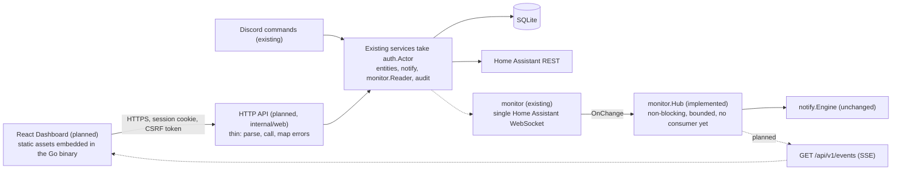
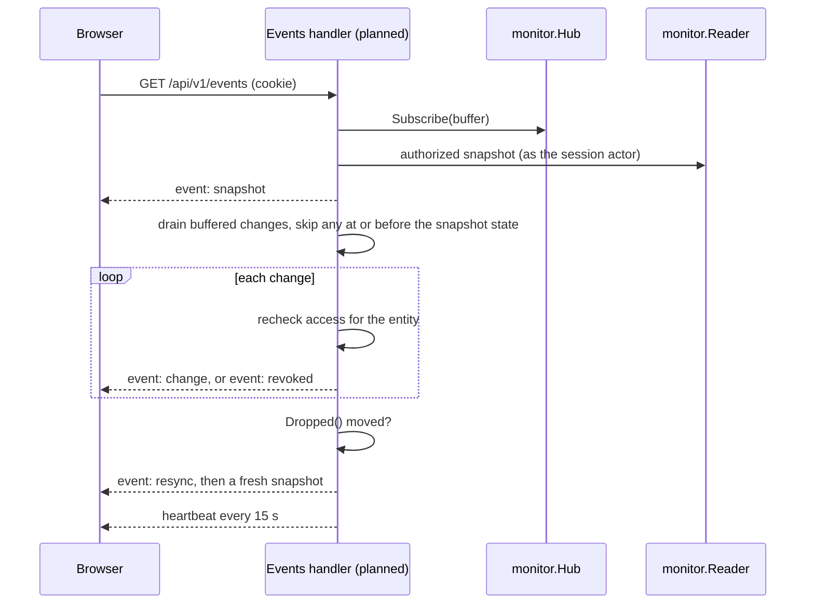
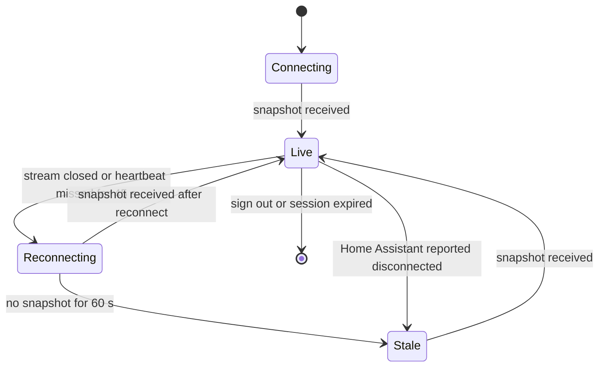

# Dashboard (v0.6.0): architecture and UI direction

| | |
| --- | --- |
| Architecture status | **Accepted** for decisions D1 to D7 (section 3), approved by the owner |
| UI direction status | **Proposed**, pending review of the visual mockups. No React is written until it is approved |
| Implemented | **Only the monitor fan-out hub** (`internal/monitor/hub.go`, wired in `cmd/nepthass/main.go`). It is infrastructure: it has no consumer and no Dashboard feature exists |
| Planned | HTTP API, local authentication, REST endpoints, SSE, the React application (sections 5 to 11) |
| Deferred | rule editing, notification history, user management, generic sensor configuration, the setup wizard, Discord OAuth2, multi-instance deployment |
| Baseline | `main` at `ed81822` (v0.5.0 plus the sensor registry hardening). Line references are to that commit |
| Related | [`architecture.md`](../architecture.md), [`sensor-registry-audit.md`](sensor-registry-audit.md), [`dynamic-sensor-types-design.md`](dynamic-sensor-types-design.md), [`roadmap.md`](../roadmap.md) |

## 1. Goal and scope

An independent, installable web dashboard served by the NeptHass binary. An administrator sees Home Assistant and service health, the shared devices with live state and the monitored sensors, and operates the devices NeptHass already allows to be controlled. It reuses the same services, authorization and business rules as the Discord commands. **Generic sensor monitoring and dynamic sensor types remain out of scope** ([design](dynamic-sensor-types-design.md)); the Dashboard only shows what the backend already supports.

## 2. Verified baseline

| Area | Finding |
| --- | --- |
| Services take a plain actor | `entities.Service.Status`, `Devices`, `Suggest` (`internal/entities/service.go:61,99,149`), `Control` (`control.go:22`), `monitor.Reader` (`internal/monitor/reader.go:83,106`), `audit.Log.Recent` (`internal/audit/audit.go:76`) take `auth.Actor{UserID, Level}` and enforce access themselves |
| Business rules live in services | the Discord layer is thin |
| Identity is Discord only | levels come from `DISCORD_ADMIN_USER_IDS` and `DISCORD_ALLOWED_USER_IDS` through a guild-aware `Authorizer` (`internal/auth/auth.go:69`; `internal/config/config.go:87-88`); no credential, user or web-session storage exists |
| No HTTP server | the binary has none; the container is read-only and non-root (`Dockerfile:27`) with no port or healthcheck |
| One Home Assistant WebSocket | owned by the monitor (`internal/homeassistant/ws/session.go`); changes leave it through the single synchronous `Config.OnChange` (`internal/monitor/monitor.go:65,278-298`), which must be constant-time and non-blocking |
| Late-bound hook | `changeHook` (`cmd/nepthass/main.go:83,156-166`) binds the callback to the notify engine; the hub is fed through it |
| Persistence | migrations 0001 to 0004 create `command_audit_logs`, `entity_aliases`, `entity_permissions`, `known_entities`, `notification_marks`, `notification_rules`, `notification_settings`, `setup_sessions`. No users, web sessions or notification history |
| Audit table | `command_audit_logs(actor_id TEXT, command TEXT, entity_id, action, outcome IN ('success','denied','error'), detail)` (`migrations/0001_foundation.sql:16-25`); no value validation beyond the outcome set |
| Control allowlist | `light` and `switch` only (`internal/entities/entity.go:32-39`) |
| Sensor coverage | the monitor tracks only the ten registry classes; every other entity is visible through REST reads only |

## 3. Accepted decisions

| # | Decision | Notes |
| --- | --- | --- |
| D1 | Local administrator password authentication | the Dashboard administrator is a **local identity, separate from any Discord identity**; it never impersonates a Discord user, and a Discord user ID never grants Dashboard access |
| D2 | In-memory sessions for the MVP | a restart invalidates every session; no migration; one instance only |
| D3 | Read-only rules overview is optional | must not delay the MVP |
| D4 | Reuse the audit `command` field | `dashboard.*` names (section 5.4); no migration |
| D5 | Disabled by default | `DASHBOARD_ENABLED=false`: no listener is opened |
| D6 | Documentation cleanup is a separate task | not part of this change |
| D7 | This architecture is Accepted | the UI direction stays Proposed until mockups are reviewed |

## 4. Authentication, sessions and authorization

- **Credential.** The administrator password is supplied only as a hash (`DASHBOARD_PASSWORD_HASH`), produced by a helper that reads the password from standard input, so no plaintext is ever stored in configuration or shell history. Hashing uses a salted, slow key-derivation function from the standard library (PBKDF2-HMAC-SHA-256 with at least 600,000 iterations, to be confirmed against the toolchain at implementation) and a constant-time comparison. No new dependency is introduced.
- **Brute force.** A per-client and a global exponential backoff on failed logins, a uniform "invalid credentials" answer, and an audit entry per failure.
- **Rotation and recovery.** Rotate by replacing the hash and restarting, which also invalidates all sessions. Recovery requires access to the host configuration; there is no e-mail or remote reset.
- **Sessions.** A 256-bit random token from `crypto/rand`; only its SHA-256 is kept in memory. Idle timeout 30 minutes (sliding) and an absolute lifetime of 12 hours; a small cap on concurrent sessions. Logout deletes the session server-side. **In-memory sessions expire on restart, are not shared between instances and are therefore single-instance only.**
- **Cookie and CSRF.** `HttpOnly`, `Secure` whenever the public URL is HTTPS, `SameSite=Strict`, host-only. Every state-changing request carries a CSRF token bound to the session and is subject to the origin check below.
- **The browser never supplies its authorization level.** The server builds `auth.Actor{UserID: "dashboard:admin", Level: auth.LevelAdmin}` from the session on every request. Request bodies, headers and query strings are never read for identity or level.
- **Authorization.** Every sensitive endpoint calls the same service method Discord uses, which re-checks sharing and control access; handlers contain no permission logic.

## 5. API architecture (planned)



### 5.1 Endpoints (only those with a real use case)

`POST`, `GET`, `DELETE /api/v1/session`; `GET /api/v1/health`; `GET /api/v1/devices` (paged like `Devices`) and `GET /api/v1/devices/{id}`; `POST /api/v1/devices/{id}/control`; `GET /api/v1/sensors`; `GET /api/v1/events`; optional: `GET /api/v1/rules`, `GET /api/v1/audit`.

### 5.2 Contracts and errors

JSON only, versioned under `/api/v1`. Typed service errors map to status codes (400 validation, 401 no session, 403 forbidden, 404 unknown **or unshared**, 409 conflict, 429 rate limited, 502 Home Assistant unreachable, 500 internal); the body carries a stable machine code and a short message, never an internal error string. Lists are paged exactly like the services (page size and ceiling are the service's). A request body limit and strict content-type checks apply everywhere.

### 5.3 Reverse proxy and network security

- **Default bind is loopback** (`127.0.0.1`); a non-loopback bind is refused unless `DASHBOARD_ALLOW_REMOTE=true` and the public URL is HTTPS.
- **`X-Forwarded-*` headers are ignored** unless the immediate peer is inside `DASHBOARD_TRUSTED_PROXIES` (an explicit list of addresses); only then are the forwarded protocol, host and client address used, and only from the right-most trusted hop.
- **Host validation** against `DASHBOARD_ALLOWED_HOSTS`; **origin validation** on every state-changing request against the configured public URL; no permissive CORS (same origin only).
- **HTTPS** is terminated by the reverse proxy; cookies are `Secure` when the public URL is HTTPS; HSTS only when HTTPS is confirmed.
- Strict CSP (no inline scripts), `X-Content-Type-Options`, `Referrer-Policy: no-referrer`, `frame-ancestors 'none'`.

### 5.4 Audit convention (D4)

The existing fields keep their meaning. `actor_id` is the authenticated local identity, namespaced as `dashboard:admin` (never a Discord snowflake, never supplied by the browser). `command` identifies the surface: `dashboard.session.login`, `dashboard.session.login_failed`, `dashboard.session.logout`, `dashboard.device.control`. `action`, `entity_id`, `outcome` (`success`, `denied`, `error`) and `detail` (never a secret) are used as for Discord. **Consequence:** `/audit` formats the actor as a Discord mention (`internal/discord/commands/admin.go:185`), which would show `<@dashboard:admin>` as raw text; rendering a non-numeric actor as plain code text is a small change required in the device-control phase.

### 5.5 Rate limiting, health, shutdown

A small standard-library token bucket per client and per session, stricter on login. `GET /api/v1/health` reports Home Assistant connection (`monitor.Status`, `monitor.go:306`), database reachability and the version, and nothing secret. The server starts only when enabled and shuts down gracefully with the process context already used in `cmd/nepthass/main.go:49`.

### 5.6 Service extractions required

(1) a web actor producer (the existing `Authorizer` is guild-aware); (2) an HTTP error mapping; (3) the pure registry-meaning part of the neutral rendering policy moved out of `internal/discord/ui`; (4) rule listing moved out of `discord.NotificationAdmin` (read before estimating); (5) `/audit` actor rendering (above).

## 6. Real-time updates

### 6.1 The hub (implemented, infrastructure only)

`monitor.Hub` fans the single change stream out to bounded, non-blocking subscriptions. `Publish` is constant-time and never blocks on a consumer (it may wait only for the few instructions of a concurrent `Subscribe` or `Close`); a slow subscriber loses changes, which `Dropped()` counts; `MaxSubscribers` (64) and a per-subscriber buffer (at most 1,024) bound memory; `Close` is idempotent; the hub starts no goroutines. `changeHook` feeds the hub first and then the notify engine exactly as before, so a recovered engine panic cannot cost a subscriber a change. With no subscriber the hub does nothing. There is no second Home Assistant connection.

### 6.2 The consumer contract (planned)

A bounded queue alone cannot give a consistent browser state, so the consumer owes the following.



1. **Subscribe first, then snapshot,** so no change can fall between them. The consumer applies buffered changes idempotently: a change whose `last_updated` is not newer than the snapshot's state for that entity is ignored (the tracker orders updates the same way, `internal/monitor/tracker.go:171`). If an exact snapshot sequence is needed it is exposed when the consumer is built.
2. **Dropped events force a resync.** If `Dropped()` has moved, queued changes are discarded and a fresh snapshot is sent; a connection that cannot keep up is closed rather than served stale data.
3. **Reconnection resynchronizes.** A reconnect always starts with a snapshot; the client never resumes from a remembered position.
4. **Authorization is rechecked before every forwarded event,** as `Reader` already does on each read.
5. **Revocation invalidates visible state.** There is no permission-change feed, so each stream also revalidates its visible entities periodically (every 30 seconds) and sends `revoked` for any that lost access; the client **deletes** that state, it does not merely hide it. An expired or logged-out session ends the stream with 401.
6. **Unsupported sensor classes have no push events** (the monitor tracks only the ten registry classes). They are refreshed by re-reading the REST snapshot every 30 seconds while the page is visible and on every reconnect; each such entity carries the time it was fetched and is shown as stale after two missed cycles. Nothing is presented as live that the stream does not carry.

### 6.3 Connection states the UI must distinguish



**Live** means a connected stream with a recent heartbeat and a successful snapshot. **Reconnecting** keeps showing the last data, dimmed and labeled "last confirmed" with its time. **Stale** shows the data with a stale badge and disables controls. Stale data is never styled as live.

## 7. UI/UX direction (Proposed)

**Official direction: Premium Dark + Apple-like Simplicity.** An original NeptHass identity: calm, spacious, quietly technical, designed for daily home use, with a dark-first theme and a carefully tuned light theme. It is explicitly not a Bootstrap admin panel, a table-heavy developer tool, a Home Assistant clone or a chart wall. Apple Home (clarity), Linear (interaction polish), Vercel (typography) and premium smart-home apps are references, not templates.

### 7.1 Brand

The mark is a single flowing wave line forming an "N", used as a monochrome glyph (favicon, login, sidebar). The product voice is plain and calm. Mockup content is always labeled as mock data.

### 7.2 Design tokens

| Token | Dark | Light | Use |
| --- | --- | --- | --- |
| `--bg` | `#0E131B` | `#F4F6F9` | app background |
| `--surface-1` / `-2` / `-3` | `#161C27` / `#1D2533` / `#263044` | `#FFFFFF` / `#F0F3F8` / `#E5EAF2` | cards, raised, pressed |
| `--border` | `rgba(255,255,255,.08)` | `rgba(15,22,34,.10)` | hairlines |
| `--text` / `-2` / `-3` | `#EEF2F7` / `#A5B0C2` / `#7E8AA0` | `#0F1622` / `#4A5568` / `#667289` | text (all at least 4.5:1 on their surface) |
| `--accent` | `#6FE3C1` | `#0B8F72` | brand, primary actions, focus ring |
| `--info` | `#7AA7FF` | `#2F6BE0` | live, reconnecting, informational |
| `--attention` | `#F3B76A` | `#B26A00` | open, warning, stale |
| `--motion` | `#B79CFF` | `#6B46D6` | motion detected |
| `--water` | `#5CC8FF` | `#0B76B3` | water detected |
| `--offline` | `#FF8A98` | `#C0364B` | system offline or failed action only |

**Rule: the accent is brand and interaction, never a sensor value.** A sensor reading "on" is never green. Status is always **icon plus text plus color**, never color alone.

Typography: Inter (variable, self-hosted, no CDN) for the interface and a monospace for entity IDs. Scale (desktop): Display 40/44 semibold, H1 28/34, H2 20/28, Body 16/24, Small 14/20, Label 12/16 medium with 0.04em tracking, numeric reading 48/52 semibold with tabular figures; wall mode adds one step. Spacing is a 4 px scale (4, 8, 12, 16, 24, 32, 48, 64). Radii: 8 controls, 14 cards, 22 sheets, 999 pills. Elevation: flat, card (hairline border plus a faint top highlight), popover, dialog; no decorative gradients, at most one very low-opacity ambient glow. Icons: one outline set at 1.75 px stroke on a 24 px grid, shipped as an inline SVG sprite (no runtime dependency).

### 7.3 Status semantics

| State | Meaning | Treatment |
| --- | --- | --- |
| Online / Offline | Home Assistant and NeptHass connectivity | accent link icon / offline color with text |
| Open / Closed | supported door, window, garage door, opening | open = attention glyph and "Open"; closed = neutral |
| Active / Inactive | motion and other supported binary classes, using registry meanings | motion color only for motion; neutral otherwise |
| Water detected | leak class | water color and icon; no safety or alarm claim |
| Warning | a real warning state | attention |
| Unavailable | entity unavailable or unknown | hatched neutral, "Not reporting" |
| Unknown class | any unsupported device class | raw state, neutral, no interpretation |
| Stale / Reconnecting | data not confirmed live | clock glyph and dimming / pulsing info ring |

Hazard or criticality is never inferred from a name or from Home Assistant metadata.

### 7.4 Pages and navigation

Login; then four destinations: **Overview**, **Devices** (with a details sheet), **Monitoring**, **Settings**. A persistent connection indicator (Live, Reconnecting, Stale) sits in the top bar with device search and the account menu.

- **Overview:** connection and service health, shared-device count, "needs attention" (unavailable, stale, open), quick controls for allowed devices, a sensor status summary. Only data the backend provides: no energy, history, rooms or analytics.
- **Devices:** cards with friendly name or alias, type icon, current state, search and filter, a details sheet, controls only where authorized (light and switch), and a stated reason when a control is disabled.
- **Monitoring:** cards grouped by supported class (doors and openings, motion, water, numeric), reliability, unavailable and stale states.
- **Settings and diagnostics:** Dashboard information, Home Assistant diagnostics, service status, version, security information, read-only configuration. No secret is ever shown.
- **Login:** one password field, accessible validation, a uniform failure message, loading feedback.

### 7.5 Responsive plan

| Form factor | Layout |
| --- | --- |
| Desktop (1200 px and up) | 248 px sidebar, content up to 1440 px, auto-fill grid with 280 px minimum cards |
| Tablet (768 to 1199 px, wall-mounted) | icon rail in landscape, bottom bar in portrait, one responsive app (no separate tablet app); touch targets at least 56 px, one larger type step, layouts stable while data updates, connection state always visible |
| Mobile (below 768 px) | bottom tab bar, single column, 44 px targets, no horizontal overflow |

### 7.6 Components

`AppShell`, `Sidebar`, `TopBar`, `ConnectionStatus`, `StatusIndicator`, `OverviewCard`, `DeviceCard`, `SensorCard`, `QuickControl`, `ConfirmationDialog`, `EmptyState`, `ErrorState`, `LoadingSkeleton`. Server state lives in TanStack Query; the connection state machine (section 6.3) lives in one hook; components are presentational and receive state as props.

### 7.7 Interaction rules

- **A device is never claimed to have changed until the backend confirms it.** Three distinct states: *accepted* (the request returned), *confirmed* (a later state read or event shows the expected state), *delayed* (no confirmation within 5 seconds: "No confirmation yet, check the device"). The control shows a pending state in between; failure shows the reason and a retry.
- Consequential actions use a confirmation dialog; loading uses skeletons; empty states explain how to share devices; connection loss, reconnection and resynchronization follow section 6.3.
- Full keyboard navigation, visible focus, touch interactions without hover-only affordances.
- Motion: 120 ms for micro feedback, 200 ms for state changes, 320 ms for navigation, one easing curve; with reduced motion, opacity-only changes and no shimmer.

### 7.8 Accessibility

WCAG 2.2 AA: contrast as in the tokens, status never by color alone, labels and live regions for state changes (polite, never for every sensor tick), focus management in dialogs and sheets, `prefers-reduced-motion` and `prefers-color-scheme` honored, automated checks in CI plus manual keyboard and screen-reader passes.

### 7.9 Frontend structure and stack

React, TypeScript, Vite, React Router, TanStack Query, plain CSS with the tokens above as custom properties; no component library. Tests: Vitest with Testing Library, `axe` checks, and Playwright with screenshots at desktop, tablet and mobile widths.

```
web/
  index.html  vite.config.ts  tsconfig.json
  src/
    api/          typed client, error mapping, event stream
    state/        connection machine, session, query setup
    design/       tokens.css, base.css, icons.svg
    components/   AppShell, DeviceCard, SensorCard, StatusIndicator, ...
    routes/       login, overview, devices, monitoring, settings
    test/
```

The result is built to `web/dist` and embedded in the Go binary.

### 7.10 UI acceptance criteria

All four pages render at the three form factors without horizontal overflow; every status has icon, text and color; no green for a sensor value; all text meets contrast; all flows work by keyboard; reduced motion is honored; no control claims success before confirmation; no unsupported metric appears; stale and reconnecting data is never styled as live; Lighthouse accessibility at least 95; screenshots at three widths reviewed against the approved mockups.

### 7.11 Mockups

High-fidelity HTML and CSS comps for Overview, Devices, Monitoring, Login, Mobile and Tablet were rendered for review during this work with **mock data**, and are not production code and not tracked in the repository. Final visual sign-off needs a design tool pass (comps, then token export). A separate `docs/design/dashboard-ui.md` is not created now; it is justified once implementation starts and this section outgrows this document.

## 8. Deployment

One binary and one container, with Go serving the embedded assets on a single port, loopback by default and disabled by default. A separate frontend container is rejected: it adds CORS and a second authentication surface. HTTPS comes from a documented reverse proxy. Development: the Vite server proxies to the Go process.

## 9. Security model

| Threat | Mitigation |
| --- | --- |
| Unauthorized control | server-side actor on every call; the light and switch allowlist is enforced by the service |
| Unshared entity exposure | services deny by default; 404 for unknown and unshared alike; access rechecked per event |
| Session hijack, token leakage | `HttpOnly`, `Secure`, `SameSite=Strict`; short sliding expiry; hashed password; no secrets to the browser |
| CSRF, cross-origin | CSRF token, origin and host checks, same-origin only |
| XSS | React escaping, strict CSP, no inline scripts |
| API abuse, brute force | rate limits and login backoff |
| Wrong identity mapping | identity only from the session; the Dashboard actor is local and namespaced |
| Accidental public exposure | loopback default, explicit remote opt-in, proxy trust list |
| Stale or revoked data | resynchronization and periodic revalidation (section 6.2) |

## 10. Roadmap

| Phase | Deliverables and files | Depends on | Acceptance, security checks, tests | Definition of done |
| --- | --- | --- | --- | --- |
| 0 Hub | `monitor/hub.go`, `main.go` wiring, tests | none | non-blocking, bounded, race-safe, engine unchanged | gates green, PR merged |
| 1 HTTP foundation | `internal/web`, config, `/health`, graceful shutdown | 0 | disabled means no listener; loopback default; no auth and no data endpoints | health tests, bind-refusal tests |
| 2 Authentication | hash helper, sessions, CSRF, rate limit, actor producer | 1 | no data endpoint reachable without a session; brute-force and CSRF tests | security review passed |
| 3 React foundation | `web/`, tokens, shell, login, shared components | 1 | responsive shell, axe clean | frontend tests, three-width screenshots |
| 4 Devices | devices endpoints and UI, search, details | 2, 3 | parity with Discord authorization | contract tests, UI acceptance |
| 5 Live state | SSE handler (hub consumer), connection machine, resync, revocation | 2, 4 | section 6.2 contract proven by tests | dropped, reconnect and revoke scenarios pass |
| 6 Control | control endpoint and UI, audit, `/audit` rendering fix | 4, 5 | three-state confirmation; allowlist enforced | audit rows verified |
| 7 Monitoring | sensors view, semantic rendering, optional read-only rules | 5 | parity with Discord output | UI acceptance |
| 8 Release | real Home Assistant integration, API security tests, browser E2E, visual QA, Docker packaging, docs | all | full suite, threat table covered | release-readiness report |

## 11. Future compatibility

Generic sensor monitoring and dynamic sensor types, when approved, add capabilities behind the same service contracts, so handlers and the UI do not change shape. The actor producer is the only place identity is decided, so OAuth2 or multi-user support replaces it without touching handlers. No plugin framework or dynamic registry is introduced.

## 12. Limitations and risks

In-memory sessions end on restart and do not work across instances. The first design of the SSE consumer must prove the subscribe-then-snapshot ordering with tests. Revocation is detected within one revalidation interval, not instantly. The visual direction is not approved until its mockups are reviewed.

**Next step: Phase 1, the HTTP API foundation** (an optional server, disabled by default and loopback only, with `GET /api/v1/health`, graceful shutdown, and no authentication or device endpoints).
