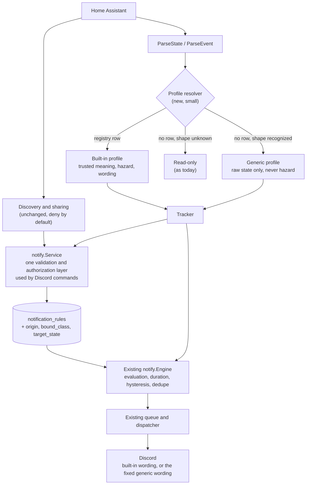

# Dynamic sensor types and generic monitoring: design

| | |
| --- | --- |
| Status | **Design proposal. Nothing is implemented, approved or scheduled.** |
| Baseline | `fba3d00` (v0.5.0). The hardening work on `fix/sensor-registry-hardening` (registry-owned alert wording, neutral status rendering, registry-derived type lists, golden wording tests) was present as uncommitted changes when this was written and is assumed to land first; it is not modified by this document |
| Related | [`sensor-registry-audit.md`](sensor-registry-audit.md) (kept intact; its findings are inputs, not conclusions to re-argue) |
| Labels | **[code]** read in the repository, **[audit]** established by the registry audit, **[inference]** reasoning not yet tested, **[proposal]** a design choice |

## 1. Executive summary

**Can an unknown sensor type be monitored without a Go change per `device_class`? Yes, for a restricted set of generic capabilities, and only through an explicit administrator action.** The recommended design is **Option B, a generic rule adapter**: the typed registry stays the only source of trusted meaning (polarity, hazard status, wording, start-up behavior), and a second, deliberately weaker *generic* profile lets an administrator create threshold rules on unknown numeric sensors and raw-state rules on unknown binary sensors, reusing the existing rule service, engine, queue and delivery.

- **Metadata may restrict, never elevate.** A `device_class` can add friction (a warning, a confirmation) but can never grant trust, severity or a safety wording. This is the central safety rule.
- **Phase 1 (generic numeric threshold) is the smallest production-worthy MVP.** It reuses `above`/`below`, hysteresis, duration and unit binding unchanged.
- **One small additive migration is recommended** (three columns, section 9) so a generic rule is never silently reinterpreted if a built-in row for its class ships later. Without it, a generic rule could change meaning on upgrade. No new rule kind, so no table rebuild.
- **Smoke, gas and carbon monoxide stay outside trusted monitoring.** They can only ever have an *informational* generic rule with an unmistakable "not a safety alarm" notice. Trusted safety monitoring remains a separate, explicit, reviewed registry row.
- **Release.** Not part of the v1.0.0 stabilization scope. Reconsider only after the stable Discord-only release, with demonstrated demand and a separate implementation decision.

## 2. Verified current behavior

| Stage | Where [code] | Behavior for an unknown class today |
| --- | --- | --- |
| Discovery | `internal/entities/discovery.go:50-68` | every entity is kept; discovered |
| Metadata extraction | `internal/monitor/update.go:48,77-110` | reads `device_class`, unit, friendly name only |
| Classification | `internal/monitor/registry.go:164-167`, `update.go:108` | no row: empty `Category` |
| Tracking | `internal/monitor/tracker.go:152-159` | **an empty category is never stored; a tracked sensor whose class stops matching is removed** |
| Capability resolution | `registry.go:20-31,108-112`; `internal/notify/rules.go:94-116`; `service.go:495-528` | capabilities exist only on a registry row |
| Sharing | `internal/entities/permissions.go:17-22,85-94`; `grant.go:5-8` | read sharing works for any entity (deny by default) |
| Rule creation | `internal/notify/service.go:212-276` | refused: shared check, then `ErrNotMonitored` (`:233,:237`) |
| Rule storage | `migrations/0004_notification_rules_v2.sql:17-26` | `kind IN ('state','above','below')`; threshold, clear, `unit` (bound), duration, cooldown; **no class, origin or target-state column** |
| Evaluation | `rules.go:135-193`; `engine.go:579` | needs a tracked sensor and a registry row |
| Delivery | `internal/notify/message.go`; `internal/discord/notifytext.go` | wording and lane come from the row (and `Hazard`) |

**Why unknown types cannot be monitored today:** the tracker drops them at ingestion, so there is no state to evaluate; and eligibility, wording, cooldown and hazard status are all read from a registry row that does not exist. Both are intentional fail-closed behavior [audit].

## 3. Product requirements

R1 unknown sensors become monitorable **only** by explicit administrator action; R2 discovery, sharing, eligibility, configuration, activation and severity stay independent; R3 built-in behavior is byte-for-byte unchanged; R4 no second notification engine; R5 Discord commands call the same validation and authorization service used by the notification engine; R6 generic rules never claim safety status; R7 a metadata change never silently reinterprets a rule.

## 4. Proposed architecture

**Path A, built-in:** unchanged. **Path B, generic:** a *profile* with `Origin = Generic`, derived from observable state, with a fixed, small capability set. The engine already branches on capability bits (`rules.go:94-109`), so a generic profile is another capability set, not another engine.

**Resolver rules [proposal].** An entity gets a generic profile only if (a) its domain is `sensor` or `binary_sensor`, (b) it has no registry row, and (c) its observed shape is recognized (below). The profile is *derived at ingestion* and **never stored as a class**; the rule stores what the administrator confirmed.

## 5. Generic capability model

| Shape | Recognition (observed, never from the name) | Generic capabilities | Not available |
| --- | --- | --- | --- |
| **Numeric** | domain `sensor`, a finite number that parses strictly, a non-empty unit (or an explicit "unitless" confirmation) | `above`/`below` threshold, hysteresis (clear value), duration, exact unit binding | unit conversion, ranges, hazard, startup announcement |
| **Binary** | domain `binary_sensor`, state exactly `on` or `off` | notify when the raw state **becomes `on`** or **becomes `off`** (administrator chooses), duration | any meaning of `on`/`off`, polarity, hazard, critical lane, start-up announcement |
| **Categorical** | domain `sensor`, non-numeric text | *deferred* (section 13) | everything |
| **Unsupported** | anything else, `unknown`, `unavailable`, malformed | read-only, as today | any rule |

Reuse: numeric uses `KindAbove`/`KindBelow` with `Threshold`, `Clear`, `Duration`, `Unit` exactly as in v0.5.0; the unit check is the existing exact-string bind (`rules.go:86-88`) minus the registry's documented-unit whitelist, replaced by "the unit the sensor reports now" (the audit showed the bind, not the whitelist, is what prevents wrong comparisons). Binary uses `KindState` with a new `target_state` (`on` or `off`) because a generic class has no `AlertMeaning`.

## 6. Security and safety model

| Requirement | How the design keeps it |
| --- | --- |
| Deny-by-default sharing | creating a generic rule requires the entity to be shared, re-checked at evaluation, when due and at send, exactly as today |
| Explicit admin authorization | same `AddRule` path and administrator gate; no auto-created rule, ever |
| Discovery is not activation | an eligible generic sensor is *offered*, never enabled |
| Fail closed | an invalid or ambiguous shape is read-only; a rule whose bound facts no longer match becomes dormant (section 8) |
| No severity from names | the resolver never reads the entity name or friendly name |
| Untrusted metadata cannot set policy | `device_class` and unit select *friction and display only* (a confirmation, a label); hazard, lane, polarity and startup behavior come only from a registry row |
| No critical alerts for unknown types | generic messages use the normal lane, `Hazard` is impossible for a generic profile, and an invariant test enforces it |
| No bypass of controls | cooldown, rule limits, quiet delivery and TTL apply as for any rule |

**Informational versus safety-critical.** For classes whose Home Assistant device class is `smoke`, `gas`, `carbon_monoxide`, `safety` or `problem` (a *restrictive* use of metadata), the administrator must confirm a fixed notice before saving, and every message carries it. Wording is fixed and neutral: `ℹ️ Generic monitor: **Kitchen smoke** changed to on (raw state). This is not a safety alarm and may be delayed or missed.` There is no ⚠️/🚨 icon, no critical lane, no start-up announcement, and no "detected", "alarm" or "wet" word, because those claim semantics NeptHass has not verified. A trusted smoke, gas or CO alert remains a registry row with its own reviewed wording, polarity and tests (a separate design, [audit] section 12).

## 7. Generic rule lifecycle and configuration

1. **Discovered** (always). 2. **Shared** (administrator). 3. **Monitoring eligible** (shape recognized; shown with the capability on offer). 4. **Configured** (administrator creates and confirms a rule; persisted). 5. **Active** (a reliable matching reading exists and the entity is still shared). 6. **Suspended** (dormant: see section 8, visible with a reason). The interface shows each state separately and never one "enabled" flag.

**Create flow.** Select entity, see raw state, unit and the single capability offered, enter the threshold or target state, **review a summary that names the bound unit or raw state and states it is generic**, confirm. The service re-validates everything; command input is never trusted. Edit and delete reuse the existing rule commands; editing the threshold or target keeps the binding, changing the bound unit or class requires re-confirmation.

**Discord.** The existing `/notify` commands gain a generic path chosen automatically from the eligible shape, with a confirmation step (the wizard component pattern already in `internal/discord/wizard`). The command layer calls `notify.Service`; no rule is decided in the UI layer [code: validation already lives in `service.go`, not in the command layer].

## 8. Metadata changes

| Change | Behavior | Audit entry |
| --- | --- | --- |
| Unit changes or disappears | rule **dormant**, "unit changed from `ppm` to `%`"; resumes only if the original unit returns; never converted | yes |
| `device_class` changes (or a row now exists) | rule **suspended, needs review**; never auto-promoted to built-in | yes |
| Numeric to text, binary to unknown | dormant; a duration in progress is cancelled | yes |
| `unavailable`/`unknown` | no violation, no fake value; duration cancelled (as today) | no |
| Rename | new entity ID: old rule dormant ("not found"), sync report surfaces it | yes |
| Removal | rule dormant, history kept; deletable by an administrator | yes |
| Same ID replaced by another device | detected by a class or unit change only; otherwise indistinguishable (limitation) | n/a |
| Home Assistant or NeptHass restart | restart recovery as v0.5.0: marks and summary time persisted, no replay, no duplicate | no |

## 9. Persistence

**Reuse.** `notification_rules` already stores entity, kind, threshold, clear, bound unit, duration, cooldown and enabled; authorization, delivery marks and the engine are unchanged. **Why a migration is still recommended [proposal, not implemented]:** without a stored origin, a generic rule becomes a built-in rule the day a row for its class ships, silently changing its meaning, wording and cooldown (violating R7).

| Change | Detail |
| --- | --- |
| `origin TEXT NOT NULL DEFAULT 'builtin' CHECK (origin IN ('builtin','generic'))` | existing rows stay `builtin` |
| `bound_class TEXT NOT NULL DEFAULT ''` (length <= 64) | the `device_class` seen at creation; empty for built-in |
| `target_state TEXT NOT NULL DEFAULT '' CHECK (target_state IN ('','on','off'))` | binary generic only |

Additive `ALTER TABLE ... ADD COLUMN` with defaults, **no table rebuild** and no new `kind`. **Rollback:** an older binary ignores the new columns and treats generic entities as not monitored, so those rules go dormant (safe); built-in rules are unaffected. **Backup:** the existing pre-migration backup applies. **Compatibility:** v0.5.0 rules are untouched. A categorical `equals` rule would need a new `kind` and a rebuild of the table: another reason to defer it.

## 10. Alternatives and decision matrix

| Option | Summary | Satisfies the goal? |
| --- | --- | --- |
| **A** Expand the registry | add rows in Go | **No**: still a release per class (kept as the path for *trusted* types) |
| **B** Generic rule adapter | registry stays; restricted generic profile on the same engine | **Yes** |
| **C** Capability resolver | one abstraction over built-in and generic | Yes, with a larger refactor than needed |
| **D** Runtime-configurable registry | administrators define types | Yes, and unsafe (polarity and hazard become data) |

| Criterion (weight) | A | B | C | D |
| --- | ---: | ---: | ---: | ---: |
| Safety (25) | 4 | 4 | 4 | 1 |
| Compatibility (20) | 5 | 5 | 4 | 3 |
| Maintainability (15) | 3 | 3 | 3 | 2 |
| Extensibility (15) | 1 | 4 | 4 | 5 |
| Implementation cost, higher is cheaper (10) | 5 | 3 | 2 | 1 |
| Runtime complexity (5) | 5 | 5 | 5 | 4 |
| Testability (10) | 5 | 3 | 2 | 1 |
| **Total** | **3.85** | **3.90** | **3.50** | **2.30** |

**Read this honestly:** A and B are nearly tied on the weighted score because A is simpler and fully safe; **A is disqualified by the product goal** (a Go change per class), which is a pass/fail gate, not a weight. B is the smallest design that passes the gate. C adds a general abstraction over a problem that needs two profiles; D fails safety. Database impact: A none, B three additive columns, C as B, D new tables. B and C both keep validation in the service layer.

## 11. Testing strategy

**Reuse:** registry, interpretation, reader deny-by-default, rule-engine duration, hysteresis, unit-binding and restart tests, and the real-Home-Assistant suite (`tests/integration`). **New:** (1) a generic profile is never hazard, never critical lane, never announced at start-up (invariant); (2) unknown numeric: threshold, hysteresis, duration, strict parsing (NaN, Inf, `1e999`, localized commas rejected), unit disappearance and change, dormant and resume; (3) unknown binary: raw `on`/`off` only, `unknown`/`unavailable` ignored; (4) smoke, gas and CO classes: confirmation required, fixed wording, no hazard behavior; (5) a built-in row added later does not reinterpret a stored generic rule (the `origin` guard); (6) authorization: unshared entity refused, revocation stops evaluation; (7) Discord commands and direct service tests give identical validation; (8) golden wording for the generic messages; (9) migration up on a v0.5.0 database and old-binary read; (10) restart and reconnect without duplicates. **Minimum before release:** (1), (2), (5), (6), (7), (9), plus one real-Home-Assistant run of a template numeric sensor through a unit change and an outage. Manual Discord QA should be limited to the confirmation wording.

## 12. Phased roadmap

| Phase | Goal | Code and database | Acceptance | Risk |
| --- | --- | --- | --- | --- |
| **0** | Land the hardening branch | none new | its gates green | low |
| **1** | Generic numeric thresholds (MVP) | resolver, generic profile, `AddRule` generic path, migration 0005 (3 columns), generic wording, Discord confirm flow | criteria (1), (2), (5), (6), (9) pass; v0.5.0 behavior unchanged (golden tests) | medium: new surface in a safety-adjacent area |
| **2** | Generic binary raw-state rules | `target_state` path, smoke/gas/CO friction | (3), (4) pass | medium |
| **3** | Categorical equals (only on demonstrated need) | new `kind`, table rebuild | defer until requested | high |
| Parallel | Trusted classes by registry row | per class | each its own design | per class |

**Release.** Phase 1 should **not** ride in v1.0.0, whose job is stabilization of the existing Discord-only product. Reevaluate it after the stable release. Dependencies: Phase 0, then Phase 1, then 2.

## 13. Architecture decision

1. **Monitorable without Go changes?** Yes, generically, by explicit configuration. 2. **Safe generic capabilities:** numeric threshold, hysteresis, duration, exact-unit binding; raw binary change; neither conveys safety. 3. **Must stay hardcoded:** hazard status, polarity, trusted wording, start-up behavior, critical lane, the control allowlist. 4. **Keep the registry?** Yes, it is the only trust source. 5. **Can the current engine serve generic sensors?** Yes (capability bits, duration, hysteresis, dedupe); the tracker and eligibility need a profile path. 6. **Migration?** Recommended (three additive columns); avoidable only by accepting reinterpretation risk. 7. **Administrator configuration:** select, see raw facts, choose, confirm, save, server-validated through Discord. 8. **Service boundary:** commands call `notify.Service`; no rules live in the UI layer. 9. **Metadata changes:** dormant or needs review, never reinterpreted. 10. **Smallest production-worthy MVP:** Phase 1, generic numeric threshold with unit binding.

## 14. Open questions (need product approval)

1. When, if ever, should Phase 1 follow the stable v1.0.0 release? 2. Is a three-column migration acceptable, or should reinterpretation risk be accepted to avoid it? 3. May a numeric sensor with *no* unit be monitored (with an explicit "unitless" confirmation)? 4. Should the smoke, gas and CO friction list be fixed in code or documented only? 5. Is generic monitoring opt-in per installation (a setting), given its weaker guarantees? 6. Who may create generic rules: administrators only (recommended)? 7. Is categorical monitoring wanted at all? 8. Should `state_class` (not read today) discourage thresholds on cumulative meters?

## 15. Exact code references

`internal/entities/discovery.go:50-68`; `internal/monitor/update.go:48,77-110`; `internal/monitor/registry.go:20-31,108-112,125-146,164-167`; `internal/monitor/tracker.go:15,133-186` (drop branch `152-159`); `internal/monitor/reader.go:83-136`; `internal/entities/permissions.go:17-22,85-94`; `internal/entities/grant.go:5-8`; `internal/notify/rules.go:75-193` (`unitOK` `86-88`, `supports` `94-109`); `internal/notify/service.go:212-276` (`ErrNotShared` `233`, `ErrNotMonitored` `237`), `495-546`; `internal/notify/engine.go:579`; `internal/notify/types.go:72-144` (`Rule`, `NewRule`); `migrations/0004_notification_rules_v2.sql:17-26`; `internal/discord/notifytext.go`; `internal/discord/wizard/`; `tests/integration/monitor_test.go:88`. Upstream and probe evidence: [`sensor-registry-audit.md`](sensor-registry-audit.md) sections 5 to 7.
