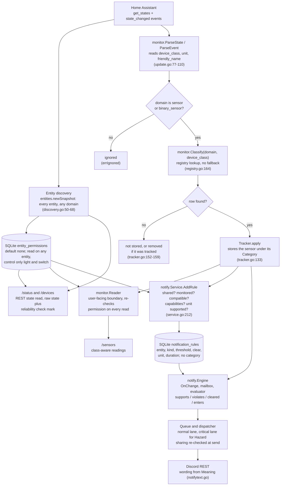

# Sensor registry and dynamic capabilities: architecture audit

| | |
| --- | --- |
| Baseline | `main` at `fba3d00` (the v0.5.0 release merge, tag `v0.5.0`), audited from the code, not from the older feature branch |
| Date | 2026-10-31 |
| Scope | Research and architecture decision only. No production code, schema, commit, tag, push or release was changed or made by this audit. Nothing here is an implementation approval |
| Evidence labels | **[code]** read in the repository (file and line), **[probe]** executed against the real code in a throw-away read-only copy, **[upstream]** read from Home Assistant's current documentation or source, **[inference]** reasoning from the above, not observed |

## 1. Executive summary

**Question.** Are sensor types still hardcoded in NeptHass, and should it evolve toward a dynamic, capability-based sensor architecture?

**Answer.** Sensor *types* are hardcoded, deliberately, in one typed Go table of ten rows (`internal/monitor/registry.go:125-146`). Everything around that table is more dynamic than the question suggests: entity discovery is fully dynamic, sharing and permissions are runtime data, units come from Home Assistant at runtime, and rule eligibility is already driven by declared capabilities rather than by category names. What is *not* dynamic is the recognition of a new Home Assistant device class, the capabilities of a class, the meaning of its states and the wording of its alerts. Those require a code change and a release.

**Recommendation: keep the current architecture and do not redesign the registry for v0.6.0.** Adopt at most one small, behavior-preserving hygiene step (section 12, steps S1 and S2) if capacity allows, and only before any new class is added. A runtime-configurable catalog (Option D) and a metadata-inferred capability model (Option C) score lowest and fail the safety requirements in ways documented below.

**Key verified findings**

1. **Unknown sensors fail closed, end to end** [probe]. All seven example sensors (smoke, gas, vibration, no device class, AQI, power, CO2) are discovered and can be shared for reading, but are never monitored, can never have a rule (every attempt is refused as "not monitored") and can never produce an alert. A name cannot promote a sensor: `binary_sensor.fake_smoke_detector` with device class `motion` is classified by its metadata (`motion`), and a Fahrenheit sensor with no device class is not classified.
2. **"One row plus tests" is not the whole cost of a new class** [probe, MEDIUM]. Adding one `Category` constant and one valid registry row (a hypothetical `occupancy` class that reuses the existing `detected`/`clear` meanings) builds and passes **every existing test** in five packages, yet the Discord alert reads "**Hall** detected motion." and "has been detecting motion for 10 minutes". Alert wording is keyed on the shared `Meaning` (`internal/discord/notifytext.go:115-124` and `:157-166`), not on the class, and no test notices. The same trap would apply to a future hazard class such as smoke, which is the sharpest argument for a small change.
3. **Two hand-written type lists already went stale** [code, LOW]. `internal/discord/commands/monitoring.go:51` and `internal/discord/commands/notifications.go:386` list the supported types and omit `garage_door` and `opening`, which v0.5.0 itself added.
4. **The generic `/status` and `/devices` views are not class-aware** [probe, LOW to MEDIUM]. Any reliable reading is rendered with a green check mark: `✅ on` for the smoke, gas and vibration examples (and for a supported garage door). The check mark means "a real reading", not "safe". This pre-dates v0.5.0 (`ReliableIcon` exists in `v0.2.0`), but it matters most for exactly the hazard-type sensors NeptHass does not support.
5. **Coverage is narrow by design, and no demand is demonstrated** [upstream, code]. Home Assistant documents 29 binary and 62 sensor device classes; NeptHass supports 7 and 3. The repository has no issues, and the class table changed in two commits in the project's history.
6. **Home Assistant metadata cannot supply the safety-relevant capabilities** [upstream]. Which state is the alarming one (for example `connectivity` and `lock` read opposite to intuition) and whether a class is a hazard exist only as prose in Home Assistant's documentation. They cannot be inferred from metadata, so they must remain explicit, reviewed code.

**Is there a demonstrated user-facing problem?** Not an external one. The only verified problems are findings 2 to 4, all small and all about maintainability and wording, not about the behavior of the supported classes.

## 2. Current architecture

NeptHass classifies a Home Assistant entity once, from two metadata fields, through a single lookup:

```
(domain, device_class)  ->  registry row (Spec)  ->  Category  ->  capabilities, polarity, units, cooldown, hazard
```

The ten inspection questions, answered from the code:

| # | Question | Answer | Where |
| --- | --- | --- | --- |
| 1 | Where are sensor types defined? | One slice of ten `Spec` rows; `Category` string constants repeat the keys | `internal/monitor/registry.go:125-146`, `internal/monitor/classify.go:7-18` |
| 2 | Where is `device_class` interpreted? | Read from the attributes, then looked up; an unknown pair gives an empty category, not an error | `internal/monitor/update.go:48,93,108`; `registry.go:162-167` |
| 3 | Where are entity domains checked? | Monitoring accepts only `sensor` and `binary_sensor`; control only `light` and `switch` | `classify.go:21-24,34-36`; `internal/entities/entity.go:28-39` |
| 4 | Where are capabilities assigned? | Declared per row as five capability bits | `registry.go:20-31,108-112` |
| 5 | Where is notification eligibility decided? | `supports`, `compatible` and `checkCapabilities` consult the row's capability bits and hazard flag | `internal/notify/rules.go:94-116`; `service.go:495-528` |
| 6 | Where is default alert behavior defined? | Cooldown, alert state and polarity in the row | `registry.go:56-66`; `rules.go:197-211` |
| 7 | Where are labels and messages generated? | Label, noun and phrase in the row; alert wording in two switches on `Meaning` | `registry.go:47-49`; `notifytext.go:104-168`; `meaning.go:29-50` |
| 8 | Where are numeric units interpreted? | The row lists the documented units; a rule binds to the unit the sensor reports and compares only that exact string | `registry.go:59-63,90-106`; `rules.go:86-88`; `service.go:212-276` |
| 9 | Where are state transitions evaluated? | `enters`, `violates`, `cleared` and the engine's `observe` | `rules.go:135-193`; `internal/notify/engine.go:579` |
| 10 | Where are permissions and exposure enforced? | Deny-by-default grants in SQLite; the reader re-checks on every read; rule creation re-checks | `internal/entities/permissions.go:17-22,85-94`; `internal/monitor/reader.go:106-136`; `service.go:228-241` |

**The registry's own claim holds for categories.** A search for category constants and `case` branches outside `internal/monitor` finds none. What it does not hold for is the *meaning vocabulary*: `Meaning` constants (`meaning.go:13-26`) and the two wording switches in `notifytext.go` form a second closed table outside the registry (finding 2).

**The `Hazard` flag is one boolean with twelve consumers in seven files**, each implementing a different behavior: immediate-only validation (`service.go:497`), the critical lane and its priority (`internal/notify/message.go:117,122,137`), fail-loud from an unreliable state (`rules.go:189`), start-up announcement (`internal/notify/initialstate.go:63,188,193`), persisted delivery marks (`engine.go:896`) and two wording branches in the Discord commands (`notifications.go:206,571`). It is cohesive on purpose: a hazard is explicit, immediate-only and announced, never inferred or configurable (`registry.go:68-72`).

## 3. Sensor lifecycle



| Stage | Package and function | Input and output | Static or dynamic | Configuration | Persistence | Failure handling | Authorization boundary |
| --- | --- | --- | --- | --- | --- | --- | --- |
| Discovery | `entities.Service`, `newSnapshot` (`discovery.go:50`) | REST states in, compact items out | **Dynamic** (every entity, any domain, nothing stored) | none | none (30 s cache) | errors do not poison the cache | administrator-only listing |
| Classification | `monitor.ParseState`, `Classify` | state object in, `Update` with `Category` out | **Static table** keyed by Home Assistant metadata | none | none | malformed input is `ErrInvalid`; unknown class is an empty category | n/a (ingestion is authorized by the Home Assistant token) |
| Registry and capabilities | `monitor.Spec`, `Caps` | category in, capabilities out | **Static**, compile-time | none | none | no fallback row exists | n/a |
| Tracking | `Tracker.apply` | `Update` in, `Change` out | dynamic state, static class | `MaxTracked` 10,000 | memory only | unknown class dropped; class that disappears removes the sensor | n/a |
| Sharing | `entities.Permissions` | entity ID in, access out | **Dynamic** (administrator data) | none | SQLite | store failure fails closed | deny by default |
| Reading | `monitor.Reader` | actor and ID in, `View` out | dynamic | none | none | permission read failure fails closed | re-checked on every read |
| Rule creation | `notify.Service.AddRule` | `NewRule` in, rule out | capability-driven | none | SQLite, audited | each refusal has a typed error | administrator only; sharing and monitoring required |
| Evaluation | `notify.Engine` | `Change` in, `Message` out | capability-driven | engine settings | marks and summary time only | dormant rule, never a wrong one | sharing re-checked at evaluation, when due and at send |
| Delivery | dispatcher and notifier | `Message` in, REST post out | static wording per `Meaning` | alert channel | SQLite marks after delivery | retry, TTL, circuit breaker | sharing re-checked at send |

## 4. Supported sensor type inventory

Source: `internal/monitor/registry.go:125-146`. "Dynamic?" is **no** for every row: each is compile-time, and none can be changed at run time.

| Sensor type | HA domain | Device class | Capabilities | Default behavior | Defined in | Dynamic? |
| --- | --- | --- | --- | --- | --- | --- |
| `temperature` | `sensor` | `temperature` | threshold, threshold duration, hysteresis | units °C, °F, K; cooldown 15 min | `registry.go:126-127` | no |
| `humidity` | `sensor` | `humidity` | same | unit %; range 0 to 100; cooldown 15 min | `registry.go:128-129` | no |
| `battery` | `sensor` | `battery` | same | unit %; range 0 to 100; cooldown 6 h | `registry.go:130-131` | no |
| `battery_low` | `binary_sensor` | `battery` | state, state duration | on = low; cooldown 6 h | `registry.go:132-133` | no |
| `motion` | `binary_sensor` | `motion` | state, state duration | on = detected; cooldown 5 min | `registry.go:134-135` | no |
| `door` | `binary_sensor` | `door` | state, state duration | on = open; cooldown 1 min | `registry.go:136-137` | no |
| `window` | `binary_sensor` | `window` | state, state duration | on = open; cooldown 1 min | `registry.go:138-139` | no |
| `garage_door` | `binary_sensor` | `garage_door` | state, state duration | on = open; cooldown 1 min | `registry.go:140-141` | no |
| `opening` | `binary_sensor` | `opening` | state, state duration | on = open; cooldown 1 min | `registry.go:142-143` | no |
| `leak` (water) | `binary_sensor` | `moisture` | state only (immediate) | on = wet; cooldown 15 min; **hazard**: critical lane, fail-loud, announced at start-up | `registry.go:144-145` | no |

**Coverage of Home Assistant's documented classes** [upstream]: 7 of 29 `BinarySensorDeviceClass` values (`battery`, `door`, `garage_door`, `moisture`, `motion`, `opening`, `window`) and 3 of 62 documented sensor device classes (58 numeric, 4 non-numeric). Not covered, and notable: `smoke`, `gas`, `carbon_monoxide`, `safety`, `problem`, `tamper`, `vibration`, `occupancy`, `presence`, `connectivity`, `lock`, `power`, and the numeric `carbon_dioxide`, `aqi`, `pm25`, `power`, `illuminance` and `voltage`.

## 5. Static versus dynamic classification

The word "dynamic" is used below only with one of these five meanings.

| Concept | Verdict | Evidence |
| --- | --- | --- |
| **Dynamic entity discovery** (find new entities without code changes) | **Yes** | `newSnapshot` keeps every state Home Assistant reports, with no domain or class filter (`discovery.go:50-68`); all seven example sensors were discovered [probe] |
| **Dynamic type recognition** (recognize a new `device_class` without code changes) | **No** | An unknown pair gives an empty category (`update.go:108`) and the tracker refuses to store it (`tracker.go:152-159`); every example class was untracked [probe] |
| **Dynamic capability resolution** (derive supported features from metadata) | **Partly, by lookup only** | Capabilities are resolved at run time from the entity's `device_class`, but through a static table, so a class with no row has no capabilities (`registry.go:164-167`) |
| **Dynamic behavior definition** (new alert behavior without Go changes) | **No** | Polarity, cooldown, hazard, units, wording and capability bits are all Go (`registry.go`, `notifytext.go`) |
| **Runtime extensibility** (an administrator configures an unknown sensor type safely) | **No, by design** | No command or setting adds a class; the design considered and rejected a catalog (`docs/design/rules-v0.5.0.md`, section 6) |

**Everything that is hardcoded** (not only the registry):

| Item | Where | Notes |
| --- | --- | --- |
| Class rows | `registry.go:125-146` | the intended single source |
| `Category` constants | `classify.go:7-18` | duplicate the row keys; `Registry_everyCategoryConstantHasARow` enforces agreement |
| Monitored domains | `classify.go:21-24,34-36` | `sensor`, `binary_sensor` |
| `Meaning` vocabulary and `Meaning.Text` | `meaning.go:13-50` | closed set of twelve meanings |
| Alert wording per meaning | `notifytext.go:104-168` | falls back to "changed state" and "has been in its alert state" for an unlisted meaning |
| Rule kinds | `internal/notify/types.go`, `migrations/0004_notification_rules_v2.sql` | `state`, `above`, `below` (a CHECK constraint) |
| Capability bits | `registry.go:20-31` | five |
| User-facing type lists | `monitoring.go:51`; `notifications.go:103,386` | stale for `garage_door` and `opening` (finding 3) |
| Control allowlist | `entity.go:28-39` | `light`, `switch`; every other domain refused until a security review |

## 6. Unknown sensor behavior

These examples are **hypothetical** Home Assistant entities. They were run through the real code paths in a throw-away copy of the repository mounted read-only in a container (the working tree was verified unchanged afterwards); the Discord layer was exercised through its real formatting functions, not through a live bot. "Discord output" is what the code renders.

| Entity (device class, state) | Discovered | Shareable | In `/devices` | Monitored | Rule possible | Duration | Threshold | Discord output | Unsafe or misleading |
| --- | --- | --- | --- | --- | --- | --- | --- | --- | --- |
| `binary_sensor.kitchen_smoke` (`smoke`, on) | yes | read yes, control no | yes, once shared | **no** | no: "not monitored" | no | no | `/status`, `/devices`: `✅ on`; never in `/sensors`; no alert | **Yes: a smoke alarm in alarm renders as `✅ on`** |
| `binary_sensor.basement_gas` (`gas`, on) | yes | read yes | yes | no | no | no | no | `✅ on` | **Yes, same** |
| `binary_sensor.storage_vibration` (`vibration`, on) | yes | read yes | yes | no | no | no | no | `✅ on` | Misleading, lower severity |
| `binary_sensor.custom_device` (no class, on) | yes | read yes | yes | no | no | no | no | `✅ on` | Neutral |
| `sensor.air_quality_index` (`aqi`, 112) | yes | read yes | yes | no | no | no | no | `✅ 112` | Neutral |
| `sensor.power_consumption` (`power`, 1500 W) | yes | read yes | yes | no | no | no | no | `✅ 1500 W` | Neutral |
| `sensor.co2_level` (`carbon_dioxide`, 850 ppm) | yes | read yes | yes | no | no | no | no | `✅ 850 ppm` | Neutral, but a hazard-type reading |
| *control:* `binary_sensor.garage` (`garage_door`) | yes | read yes | yes | **yes** | state: allowed | allowed | n/a | `/sensors` class-aware; alerts "is now open" | none |
| *control:* `sensor.attic` (`temperature`, 31 °C) | yes | read yes | yes | **yes** | above: allowed | allowed | allowed, bound to °C | rises above N °C | none |
| *name trap:* `binary_sensor.fake_smoke_detector` (`motion`) | yes | read yes | yes | yes, as **motion** | state: allowed | allowed | n/a | "detected motion" | none: classified by metadata, not by name |
| *name trap:* `sensor.kitchen_temperature_f` (no class, °F) | yes | read yes | yes | **no** | no | no | no | `✅ 88 °F` | none: never inferred from the name |

The "In `/devices`" column comes from reading the code (`devices.go:63` formats any shared entity), while the rendering shown was executed [probe]. Further behavior observed [probe]: a lock entity (`lock.front_door`) is ignored by the monitor; a tracked temperature sensor that later reports no device class is **removed** from monitoring (so its rules become "not monitored", not wrong); rule creation refuses an unshared entity before it checks whether it is monitored.

**The cost of adding a class, measured** [probe]. In a copy, one `Category` constant plus one registry row for `occupancy` (reusing `detected`/`clear`) compiled and passed all tests in `internal/monitor`, `internal/notify`, `internal/discord`, `internal/discord/commands` and `internal/discord/wizard`. The rendered alert was `⚠️ **Hall** detected motion.` and, with a ten minute duration, `⚠️ **Hall** has been detecting motion for 10 minutes.` Correct wording would need a new `Meaning`, a `Text` case and two `notifytext.go` cases, none of which any test requires.

## 7. Security and safety review

### 7.1 Requirements checklist

| Requirement | Status | Evidence |
| --- | --- | --- |
| Deny-by-default entity sharing | **Met** | `AccessNone` is the default (`permissions.go:17-18,85-94`); read on any entity must be granted explicitly (`grant.go:5-8`) |
| Server-side permission enforcement | **Met** | The reader re-checks on every read (`reader.go:29-34,83-102,106-127`); rule creation, evaluation, due-time firing and dispatch re-check sharing |
| No unauthorized entity exposure | **Met** | An unshared entity looks like an unknown one (`Reader_isDenyByDefault_andAnUnsharedEntityLooksLikeAnUnknownOne`); unshared and unknown examples are refused identically in rule creation [probe] |
| Conservative hazard classification | **Met** | `Hazard` is set only on the water-leak row and never inferred or configurable (`registry.go:68-72,144-145`); only a binary class may be a hazard (`registry_test.go:144`) |
| No promotion of unknown sensors to hazards | **Met** | Unknown classes have no row, hence no flag [probe]; a metadata-identical `motion` sensor named "smoke" stays `motion` [probe] |
| Explicit validation of supported units | **Met** | Only documented units are accepted at creation and the bound unit must match exactly (`registry.go:90-97`; `service.go:247-252`; `rules.go:86-88`) |
| Safe thresholds and hysteresis | **Met** | `cleared` is strict, a reading in another unit is never compared, ranges invalidate implausible values (`rules.go:135-170`; `meaning.go:102-104`) |
| Correct transition handling | **Met** | `enters` needs a reliable non-violating previous state, with one explicit hazard exception (`rules.go:182-193`) |
| Duration cancellation on unavailable | **Met** | Unreliable readings cancel the count (`engine.go:579`; verified by the v0.5.0 audit and the real-Home-Assistant tests) |
| Startup deduplication | **Met** | Delivery marks and the summary time (`initialstate.go`; v0.5.0 audit) |
| Backward compatibility with existing rules | **Met** | No column stores a category; a rule whose class no longer supports its shape becomes dormant, never deleted (`service.go:530-546`) |
| SQLite migration safety | **Met for the current design** | See section 10 |
| Messages must not mislead | **Partly** | Findings 2 and 4: wording for a future class can be silently wrong, and `/status` shows a reassuring check mark for raw hazard-type readings |

### 7.2 Hazard sensors

`water_leak` is the only hazard. `smoke`, `gas` and `carbon_monoxide` are deliberately unsupported pending a safety policy (`docs/design/rules-v0.5.0.md`). The audit confirms they are unsupported *safely* (no rule, no alert, no inference) and also shows what is missing for a user who shares one: `/status` and `/devices` show a smoke detector in alarm as `✅ on`. Two consequences for any future work:

- A hazard class added as "one row" would inherit wording from `Meaning`; reusing `detected` would announce smoke as "detected motion" (section 6). A hazard row needs its own wording, reviewed.
- The registry invariant that only a binary class can be a hazard (`registry_test.go`) means a numeric hazard (a carbon monoxide concentration in ppm) is not expressible today and needs its own design.

### 7.3 Home Assistant metadata: guaranteed versus assumed

| Field | What Home Assistant guarantees [upstream] | What NeptHass assumes or does [code] |
| --- | --- | --- |
| `entity_id` | `domain.object_id` | strict lowercase letters, digits and underscores (`entity.go:48-60`) |
| domain | derived from the entity ID | only `sensor` and `binary_sensor` are monitored |
| `device_class` | optional; for core integrations a value from `BinarySensorDeviceClass` or `SensorDeviceClass`; a custom integration or template can set any string | treated as an opaque key; length-bounded (`update.go:96`); **the only classification input** |
| `state` | a string; `unavailable` and `unknown` are reserved | those two are never treated as a value; a binary state other than `on`/`off` is `invalid` (`meaning.go:70-89`) |
| `unit_of_measurement` | native unit converted to the user's unit system; **users can change the unit of any sensor whose class has a unit converter**; a custom string that looks like a unit counts as a different unit | bound at rule creation and compared as an exact string; a different unit makes the rule dormant (verified against a real instance in the v0.5.0 audit) |
| `state_class` | optional; says whether a number is a measurement or a total | **not read**; it is not a reliable capability signal because it is optional |
| other attributes | arbitrary | only `device_class`, `unit_of_measurement` and `friendly_name` are read (`update.go:47-51`); everything else is skipped |
| `last_changed`, `last_updated` | state-change and any-update times | `last_updated` orders updates and drops stale ones (`tracker.go:171-175`); `last_changed` is an episode identity for start-up deduplication, never a claim about when something began |

**Which fields are authoritative for capability decisions?** `device_class` plus the domain, for *recognition*; `unit_of_measurement` for numeric *binding*. Nothing in Home Assistant's metadata states the alarming direction or the hazard status: the polarity table is documentation prose (`lock`: on = unlocked; `connectivity`: on = connected; `safety`: on = unsafe; `smoke`: on = smoke detected) [upstream]. NeptHass copies that contract into code, as `registry.go:120-124` documents.

**Scenarios.** Missing device classes: untracked, never guessed [probe]. Custom integrations and template sensors: classified by the same metadata; the real-Home-Assistant suite classifies template-based virtual sensors (`tests/integration/monitor_test.go:88`). Unknown values: `invalid`, never safe. Unit changes: dormant, never converted. Unavailable entities: kept visible as "not reporting" when they had a class (`classretain_test.go`). New Home Assistant device classes: unsupported until a row exists. **Renamed entities** are a different entity ID; sharing and rules keyed on the old ID stop matching, which the sync report surfaces (`Sync_recordsABaselineFirst_thenReportsNewRemovedAndReturnedEntities`); this is [inference] from the tests and was not probed.

**Unverified assumptions.** That an administrator can set a missing `device_class` on a custom sensor from the Home Assistant side (for example through its customization settings) was not verified here.

## 8. Architecture alternatives

### Option A: keep the current typed registry

The ten-row Go table as shipped in v0.5.0.

- **Safety.** Strong: explicit, fail-closed, hazards never inferred, invariants refuse an inconsistent row. Weakness: the extension path can produce wrong wording with green tests (finding 2).
- **Simplicity.** Highest: one lookup, no configuration.
- **Maintainability.** One table, but a second closed vocabulary (`Meaning` and two switches) and hand-written lists sit outside it.
- **Adding types.** A code change and a release per class. Cost today: constant, row, tests, plus any new meaning, wording switches and hand lists.
- **Testing cost.** Already paid.
- **Compatibility.** Nothing changes.

### Option B: harden the static registry

Keep every definition in Go and compile-time, but make a row self-describing and remove the leaks:

- put the alert wording in the row (an alert phrase and a held phrase), replacing the `notifytext.go` switches on `Meaning`;
- generate the user-facing type lists from `monitor.Specs()` instead of writing them by hand;
- add an invariant that every row carries complete wording, and golden tests that pin the wording of the ten current classes byte for byte.

No runtime configuration, no schema change, no new dependency.

- **Safety.** Same policy as A, plus the wording-per-class guarantee that makes a future hazard row safe to add.
- **Simplicity.** Slightly more fields per row, fewer places to edit.
- **Maintainability.** Adding a class becomes truly "one row plus its tests".
- **Adding types.** Still a release, but one reviewable row.
- **Testing cost.** A table-driven completeness test and golden wording tests.
- **Compatibility.** Messages for existing classes stay identical (golden tests prove it); no data change.

### Option C: capability-based registry inferred from metadata

Represent behavior as capabilities (`StateChangeAlert`, `DurationAlert`, `NumericThreshold`, `Hysteresis`, `UnitAware`, `StartupHazard`, `StartupSummary`) and derive them from Home Assistant metadata plus validated configuration, including generic support for any numeric sensor with a unit.

**What already exists.** The model is partly built: five capability bits are declared per row (`registry.go:20-31`) and eligibility already consults them (`rules.go:94-109`, `service.go:495-528`). `UnitAware` is the `Units` list, and `StartupHazard` is the `Hazard` flag. What C adds is *inference*.

- **Safety.** Binary capabilities cannot be inferred: the alerting direction and hazard status are not in the metadata (section 7.3). Numeric inference would make every `sensor` with a unit alertable, including `total_increasing` meters for which thresholds are meaningless, and would rest on `device_class` and unit strings that custom integrations set freely. Splitting `Hazard` into independent capabilities (critical lane, fail-loud, start-up announcement, immediate-only) would allow inconsistent combinations unless new invariants forbid them; today they cannot diverge.
- **Maintainability.** Two tiers (curated rows and inferred numeric) in every evaluation path, plus documentation of which tier a sensor is in.
- **Adding types.** Strongest of the code-based options for numeric classes; none for binary classes.
- **Testing cost.** A matrix of 58 numeric classes, unit sets and state classes, plus property tests, and real-Home-Assistant coverage of arbitrary classes.
- **Compatibility.** Existing rules and schema are unaffected, but alert wording and range validation for inferred classes would be new surface.

### Option D: runtime-configurable sensor definitions

Definitions in YAML or JSON, SQLite, administrator commands, or Home Assistant metadata.

- **Safety.** Weakest. Polarity and hazard status would become data an administrator can set wrongly: an inverted polarity silently turns a safety alert into its opposite, and a configurable hazard flag contradicts the current rule that it is "never inferred or configurable" (`registry.go:70-71`). Every definition would need validation as strict as the compile-time invariants.
- **Maintainability.** A schema, a parser, versioning and reload semantics to maintain; the v0.5.0 design already rejected this ("a second place to edit and keep in sync", a new dependency for YAML).
- **Adding types.** Best: no release needed.
- **Testing and operations.** A configuration-validation test suite, migration of definitions, and an operational procedure for a bad definition.
- **Compatibility.** Needs a definition-version policy so that an edited definition cannot silently change what existing rules mean.

## 9. Weighted decision matrix

Scores run from 1 (worst) to 5 (best); for complexity and testing, a higher score means *less* complexity. Weights are the audit brief's.

| Criterion | Weight | A: keep | B: harden static | C: inferred capabilities | D: runtime config |
| --- | ---: | ---: | ---: | ---: | ---: |
| Security and safety | 25% | 4 | 5 | 3 | 1 |
| Backward compatibility | 20% | 5 | 5 | 4 | 3 |
| Maintainability | 15% | 3 | 4 | 3 | 2 |
| Extensibility | 15% | 2 | 3 | 4 | 5 |
| Implementation complexity | 10% | 5 | 4 | 2 | 1 |
| Runtime performance | 5% | 5 | 5 | 5 | 4 |
| Testing and operational complexity | 10% | 5 | 4 | 2 | 1 |
| **Weighted total** | 100% | **4.00** | **4.35** | **3.25** | **2.30** |

**Why each score** (evidence in sections 2 to 8):

- **Safety.** A = 4: the supported classes are safe and unknown classes fail closed [probe], but a new class can be added with misleading wording and green tests (finding 2). B = 5: the same policy plus wording that must be declared and tested per row. C = 3: binary capabilities cannot be inferred and numeric inference widens what can alert. D = 1: configurable polarity and hazard status break the "never configurable" property.
- **Backward compatibility.** A = 5: unchanged. B = 5: no schema or behavior change; golden tests keep wording identical. C = 4: no schema change, but new classes and ranges are new behavior. D = 3: definition versioning and a data store.
- **Maintainability.** A = 3: two closed vocabularies and stale hand lists. B = 4: one self-describing row. C = 3: two support tiers. D = 2: a configuration system.
- **Extensibility.** A = 2 (a release per class; 7 of 29 and 3 of 62 classes covered), B = 3, C = 4 (numeric only), D = 5.
- **Implementation complexity.** A = 5 (nothing to do), B = 4 (a few files, no behavior change), C = 2, D = 1.
- **Performance.** All use map lookups; D adds a cached store read.
- **Testing and operations.** A = 5 (existing suite), B = 4, C = 2, D = 1.

**Sensitivity.** The ranking does not depend on the weights.

| Weighting | A | B | C | D | Ranking |
| --- | ---: | ---: | ---: | ---: | --- |
| Audit brief (above) | 4.00 | 4.35 | 3.25 | 2.30 | B > A > C > D |
| Extensibility-heavy (extensibility 30, safety 20, compatibility 15, maintainability 15, complexity 10, performance 5, testing 5) | 3.60 | 4.10 | 3.40 | 2.80 | B > A > C > D |
| Safety-heavy (safety 40, compatibility 20, maintainability 10, extensibility 10, complexity 10, performance 5, testing 5) | 4.10 | 4.55 | 3.25 | 2.05 | B > A > C > D |
| Equal weights | 4.14 | 4.29 | 3.29 | 2.43 | B > A > C > D |

The gap between A and B is modest (0.15 to 0.45), which is why the recommendation is to *keep the architecture* and take B only as a small step, not as a project.

## 10. Database implications

**Facts** [code]. No column anywhere stores a category, device class or sensor type. `entity_permissions` holds an entity ID and an access level (`migrations/0001_foundation.sql:7-9`); `notification_rules` holds the entity ID, kind, threshold, clear value, unit and duration (`migrations/0004_notification_rules_v2.sql`), with `kind` constrained to `state`, `above` or `below`. The category is re-derived from Home Assistant metadata on every state update and rule evaluation.

**Consequences.**

- Adding a class by row needs **no migration** and no change to any rule: a new class simply makes its sensors monitorable.
- A registry change that removes a capability from a class turns affected rules dormant with a visible status (`StatusIncompatible`, `service.go:530-546`), never deleted.
- Option B needs no schema change.
- Option C needs none for inferred capabilities; a "capability revision" column would be needed only if rules had to record which inference they were created under (not required by the current evidence).
- Option D would need tables for definitions, a definition version, and a policy for rules created under a definition that is later edited or deleted. This alone is a strong reason to avoid it without a demonstrated requirement.

The audit recommends avoiding any schema change, and none is justified by the evidence. No migration was written.

## 11. Test coverage and gaps

**Present today** (all executed in the v0.5.0 gates):

| Area | Tests |
| --- | --- |
| Known and unknown device classes | `Classify_usesDomainAndDeviceClassOnly` (`model_test.go:39`); `Registry_reproducesTheV040ClassificationExactly`, `Registry_newBinaryClassesFollowHomeAssistantsContract`, `Registry_safetyClassesAreNotSupportedAndMoistureIsNotGeneric` (`registry_test.go:76,108,129`) |
| Registry consistency | `Registry_invariants`, `Registry_everyCategoryConstantHasARow`, `Registry_unitsAndRanges` (`registry_test.go:144,213,252`); `RegistryDrivesRuleBehavior`, `OnlyHazardsTravelTheCriticalLane` (`internal/notify/registry_use_test.go`) |
| Missing metadata | `ParseState_validatesUntrustedInput` (`model_test.go:118`); `Tracker_aRealValueWithoutADeviceClass_stopsTrackingBecauseItCannotBeInterpreted` and the other retained-class tests (`classretain_test.go`) |
| Numeric and binary interpretation | `Interpret_separatesRawStateFromMeaning` (`model_test.go:73`) |
| Unsupported units and runtime unit changes | the unit-safety tests in `internal/notify`, and the real-Home-Assistant test `Rules_aRealUnitChangeMakesABoundRuleDormant_andItResumesWhenTheUnitReturns` |
| Class changes at run time | `Tracker_stopsTrackingASensorWhoseClassNoLongerClassifies` (`model_test.go:316`) |
| Authorization and exposure | `Reader_isDenyByDefault_andAnUnsharedEntityLooksLikeAnUnknownOne`, `Reader_revocationAppliesImmediately_evenForAlreadyCachedData` (`reader_test.go`); `Sync_neverGrantsAccess_andKeepsPermissionsAndAliases` |
| Restart recovery | the start-up, marks and restart tests in `internal/notify`, and the real-Home-Assistant restart tests |
| Rule compatibility | the service tests for durations, clear values and statuses |
| Home Assistant integration | `Monitor_synchronizesWithTheRealHomeAssistant_andClassifiesTheVirtualSensors` (`tests/integration/monitor_test.go:88`) |
| Discovery | `Search_filtersByWordsDomainAndSet` and the snapshot tests (`discovery_test.go`) |

**Gaps** (found by this audit; none is a defect in the supported classes):

| Gap | Why it matters | Needed for |
| --- | --- | --- |
| No test that **alert wording is correct per class**, or that a new row must declare wording | The occupancy experiment passed every test with wrong wording | B (and any future class, especially a hazard) |
| No test that the **hand-written type lists** match the registry | They omit `garage_door` and `opening` today | B |
| No end-to-end test that **unsupported hazard-type classes stay unsupported** (discovered, shareable, never monitored, never alertable) | The behavior holds [probe] but is pinned only piecewise | A, B (cheap regression protection) |
| No test of **`/status` and `/devices` rendering** for hazard-type or unknown classes | The `✅ on` rendering is unpinned and untested | a UX decision (open question 1) |
| No test with an **unknown capability bit** or a row with an inconsistent combination beyond the current invariants | Only relevant if the capability set grows | C |
| No **property or fuzz test of unit strings** against arbitrary classes | Only relevant if numeric support is inferred | C |
| No **definition validation tests** | Only relevant if definitions become data | D |

## 12. Recommended approach

**Decisions** (the ten questions):

1. **Are sensor types hardcoded today?** Yes, in a compile-time table of ten rows.
2. **Where exactly?** `registry.go:125-146`, with satellites at `classify.go:7-24`, `meaning.go:13-50`, `notifytext.go:104-168` and three hand-written strings (section 5).
3. **Is entity discovery dynamic?** Yes, fully.
4. **Is capability resolution dynamic?** Partly: resolved at run time from Home Assistant metadata through a static lookup; a class with no row has none.
5. **What happens to an unknown sensor?** Discovered and shareable for reading; never monitored, never alertable, and shown with a reliability check mark in `/status` and `/devices` (section 6).
6. **Real limitations?** Narrow coverage (7 of 29 and 3 of 62 classes), a release per class, wording coupled to a shared vocabulary, stale hand-written lists, and a reassuring rendering of unsupported hazard-type readings.
7. **A demonstrated user-facing problem?** Not an external one: zero issues. The verified problems are small and internal (findings 2 to 4).
8. **Should the registry change in v0.6.0?** Not required. At most the small hygiene step below.
9. **Best option?** Keep the architecture (A) and, if any class is to be added, take Option B's small step first.
10. **Smallest safe evolutionary path?** The sequence below.

**Smallest safe path** (proposals only; nothing is approved or implemented):

| Step | Change | Size | Risk | Trigger |
| --- | --- | --- | --- | --- |
| **S1** | Generate the three user-facing type lists from `monitor.Specs()`; add a test that they match the registry | a few lines in two files | very low | any time; fixes finding 3 |
| **S2** | Move alert wording into the row (`AlertPhrase`, `HeldPhrase`), replace the two `notifytext.go` switches, add a completeness invariant and golden tests that pin today's wording byte for byte | one small refactor and tests | low, because the golden tests prove no wording changes | **before any new class is added** |
| **S3** | Add a regression test that unsupported hazard-type classes stay discovered-but-unmonitored and cannot be given a rule (the probe, made permanent) | one test | very low | with S2 |
| **S4** | Decide the presentation of `/status` and `/devices` for unsupported or hazard-type classes (for example, replace the check mark with a neutral "not monitored by NeptHass" note for a class without a row) | a UX decision first | low | open question 1 |
| **S5** | Add further non-hazard classes by row (for example `occupancy`, `power`, `connectivity`) **only after S2 and only on demonstrated demand** | one row each plus tests | low after S2 | demand evidence |

**Explicitly deferred.** Options C and D. Hazard classes (`smoke`, `gas`, `carbon_monoxide`) need their own safety design first: wording per class, the alarming polarity verified against Home Assistant's contract, how a numeric hazard would be expressed, the critical-lane and start-up budget with several hazards, and real-Home-Assistant tests. **Suggested revisit trigger for C or D:** repeated, concrete requests for more than about ten additional classes across two releases, or a maintainer who cannot keep pace with rows.

## 13. Stable-release follow-up

- **No additional registry feature is necessary for v1.0.0.** The stable release uses the existing typed registry and conservative semantics.
- **Optional hygiene, only before any new class:** S1, S2 and S3 (together a small, behavior-preserving change with no migration and no new dependency). The implementation follow-up below records that these hardening steps were completed after this audit.
- **A product decision, not an architecture one:** S4, how `/status` and `/devices` present an entity that NeptHass does not monitor. The implementation follow-up below records the neutral rendering decision.
- **Not in v1.0.0:** a configurable catalog, inferred capabilities, and any hazard class.

## 14. Open questions

1. Should `/status` and `/devices` become class-aware, and what should they say for an entity NeptHass does not monitor (and especially for a hazard-type device class)?
2. What is the policy for hazard classes (`smoke`, `gas`, `carbon_monoxide`), including a numeric hazard such as a carbon monoxide concentration?
3. Do self-hosting users need to add classes without a release? There is no evidence yet, which is the reason to wait.
4. Can an administrator reliably set a missing `device_class` on a custom or template sensor from the Home Assistant side? (Unverified here.)
5. Is `state_class` worth reading as an advisory signal (for example, to discourage thresholds on `total_increasing` meters) if numeric classes are ever widened?
6. If alert text is ever translated, wording in the row (S2) is the natural carrier: is localization on the roadmap?
7. How should a renamed entity be handled for sharing and rules? Today the old ID goes dormant and the sync report lists the change (not probed here).

## 15. Exact source references

All paths are relative to the repository root, at `fba3d00`.

- **Registry and capabilities:** `internal/monitor/registry.go` lines 15-31 (capability bits), 42-75 (`Spec`), 79-106 (`AlertMeaning`, `SupportsUnit`, `SingleUnit`), 108-112 (capability sets), 125-146 (the ten rows), 155-160 (`init`), 164-180 (`Lookup`, `SpecFor`, `Specs`).
- **Classification and meaning:** `internal/monitor/classify.go` 7-18 (categories), 21-36 (domains, `Classify`, `Monitored`), 39-56 (`Numeric`, `Hazard`, `Label`); `internal/monitor/meaning.go` 13-26 (meanings), 29-50 (`Text`), 54-56 (`Reliable`), 69-106 (`Interpret`).
- **Ingestion and tracking:** `internal/monitor/update.go` 47-51 (attributes read), 77-110 (`ParseState`), 115 (`ParseEvent`); `internal/monitor/tracker.go` 15 (`MaxTracked`), 98-110 (class retention), 133-186 (`apply`, with the unknown-class branch at 152-159); `internal/monitor/monitor.go` 202-248 (synchronization).
- **User-facing boundary:** `internal/monitor/reader.go` 29-34, 83-103, 106-136.
- **Discovery and sharing:** `internal/entities/discovery.go` 50-68, 89-114; `internal/entities/permissions.go` 17-22, 85-94; `internal/entities/grant.go` 5-8; `internal/entities/entity.go` 28-39, 113-122, 147-150.
- **Rules:** `internal/notify/rules.go` 75-193 (`reliable`, `unitOK`, `supports`, `usable`, `violates`, `cleared`, `enters`), 197-220 (cooldown, noun); `internal/notify/service.go` 212-276 (`AddRule`), 346-427 (`ConfirmUnit`, `BindLegacyUnits`), 495-528 (`checkCapabilities`, `compatible`), 530-546 (`statusOf`).
- **Hazard consumers:** `internal/notify/service.go` 497; `internal/notify/message.go` 117, 122, 137; `internal/notify/rules.go` 189; `internal/notify/initialstate.go` 63, 188, 193; `internal/notify/engine.go` 896; `internal/discord/commands/notifications.go` 206, 571.
- **Wording and hand-written lists:** `internal/discord/notifytext.go` 104-126, 150-168; `internal/discord/commands/monitoring.go` 51; `internal/discord/commands/notifications.go` 103, 386, 433, 566-585.
- **Generic presentation:** `internal/discord/commands/devices.go` 63, 78-104; `internal/discord/ui/ui.go` 25, 93-98, 105-116.
- **Schema:** `migrations/0001_foundation.sql` 7-9; `migrations/0003_notifications.sql` 23-27; `migrations/0004_notification_rules_v2.sql`.
- **Tests:** `internal/monitor/registry_test.go` 76, 108, 129, 144, 213, 252; `internal/monitor/model_test.go` 39, 73, 118, 316; `internal/monitor/classretain_test.go`; `internal/monitor/reader_test.go` 59, 77, 112; `internal/notify/registry_use_test.go` 10, 35; `internal/entities/discovery_test.go` 112, 198, 223; `tests/integration/monitor_test.go` 88.
- **Earlier decisions:** [`docs/design/rules-v0.5.0.md`](../design/rules-v0.5.0.md) (section 6, the catalog decision), [`docs/roadmap.md`](../roadmap.md) ("More sensor types"), [`docs/architecture.md`](../architecture.md).
- **Upstream:** Home Assistant developer documentation for the [binary sensor](https://developers.home-assistant.io/docs/core/entity/binary-sensor/) and [sensor](https://developers.home-assistant.io/docs/core/entity/sensor/) entities, and `homeassistant/components/binary_sensor/const.py` on the `dev` branch, read on 2026-10-31.

**How the probes were run.** Four temporary test files (discovery and grants, classification and tracking, presentation, and rule creation) and one occupancy experiment were copied into a throw-away copy of the repository inside a container, with the real repository mounted read-only, and discarded with it. They called the real `entities`, `monitor`, `ui`, `notify` and `discord` functions. The repository's working tree was verified unchanged after each run.

## 16. Implementation follow-up (branch `fix/sensor-registry-hardening`)

The architecture decision above stands: the typed static registry is kept, no sensor class was added, no schema or dependency changed. Sections 1 to 15 describe the code at `fba3d00` and are unchanged; this section records the hardening that followed (local branch, not committed).

- **Wording bound to the row (finding 2).** `monitor.Spec` gained `Alert` and `Held` ("is now open", "has been open for"). `stateClause` and `heldClause` in `internal/discord/notifytext.go` now read them from the row instead of switching on the shared `Meaning`. A row without wording degrades to the generic "changed state", never to another class's text, and `Registry_everyBinaryClassDeclaresItsOwnWording` refuses an incomplete row. The `Meaning` type is kept for state evaluation. The occupancy-style failure ("Hall detected motion.") can no longer happen silently.
- **Neutral status rendering (finding 4).** `ui.StateIcon` no longer returns the green check mark: a real reading gets an information mark and an unreliable one the warning mark. `ui.DescribeState` renders a supported binary class through the registry ("open (on)", "water detected (on)") and every other entity as its raw state with no interpretation. One helper pair (`ui.ReadingIcon` and `ui.DescribeReading`) serves `/status`, `/devices`, `/control` and the `/setup` discovery list, which also stopped using the green check mark. Unknown and unavailable keep their "(not reporting)" text and warning mark.
- **Derived lists (finding 3).** The two hand-written type lists now come from `monitor.Specs()` through `typeList` (by declared capability), so `garage_door` and `opening` appear. The light/switch control allowlist and the rule-kind constraint were left alone.
- **Tests added.** `TestGolden_stateAndDurationWordingOfEverySupportedClass` pins the exact v0.5.0 wording of all seven binary classes plus the numeric wording; `TestRegistry_everyBinaryClassDeclaresItsOwnWording`; `TestTypeList_isDerivedFromTheRegistry_soNoRegisteredClassCanBeOmitted`; `TestDescribeState_neverCallsOnHealthy_andOnlyInterpretsSupportedClasses`. One existing fixture (a digest line in `notifier_test.go`) was given its class, as production always does.
- **Intentional output change.** `/status` and `/devices`: `✅ on` for a door became `ℹ️ open (on)`; for a smoke or gas sensor `✅ on` became `ℹ️ on`. Alert and digest wording is unchanged for every supported class.
- **Remaining limitations.** Integration tests were not run for this change. The golden and rendering tests were not mutation-checked. Numeric-class wording is still produced from the threshold, and the `Meaning` vocabulary remains closed. No manual Discord QA has been done.
