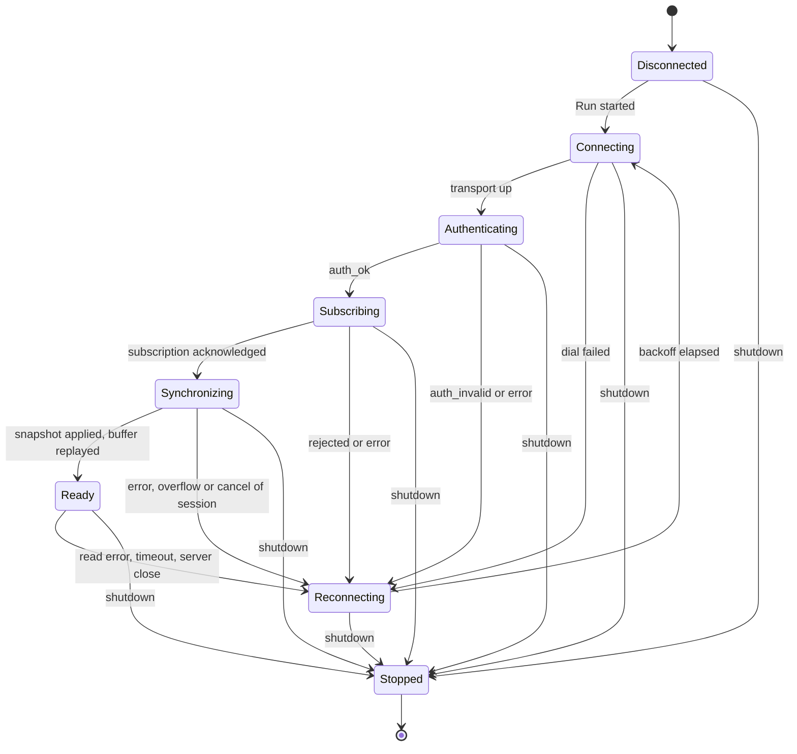
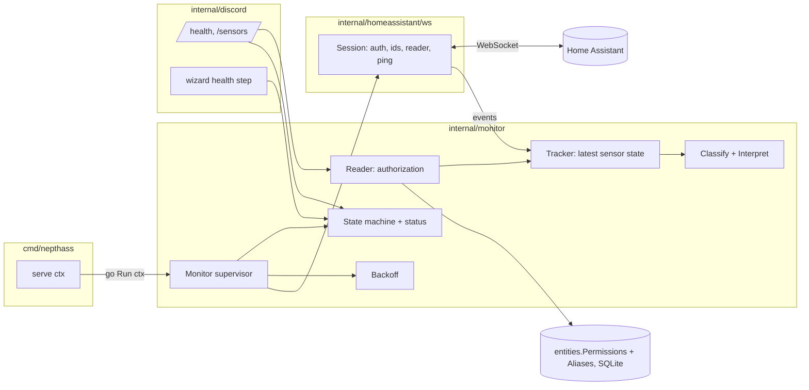
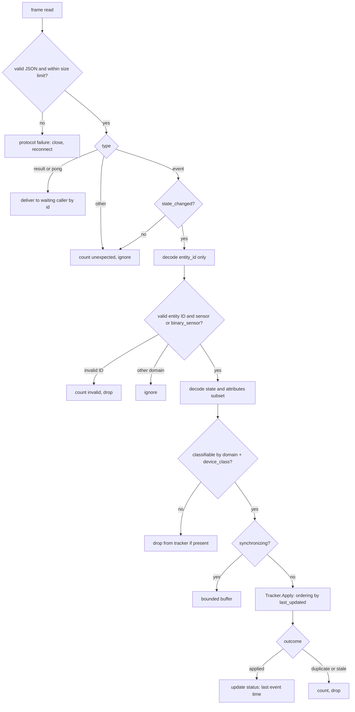
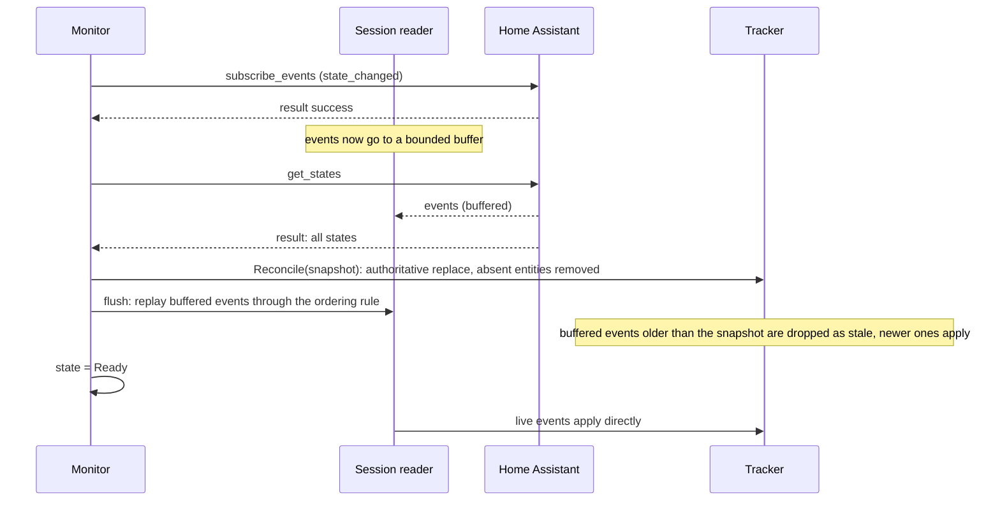

# v0.3.0 design: Sensor Monitoring

Status: implemented on `feature/v0.3.0` (unreleased, awaiting manual acceptance). This document records the decisions the implementation follows; [../architecture.md](../architecture.md) describes the resulting system.

## Goals

- Keep one authenticated WebSocket connection to Home Assistant and receive `state_changed` events in real time.
- Maintain the latest known state of the sensors NeptHass understands, with explicit freshness and ordering rules.
- Recover from disconnections safely: bounded backoff with jitter, no duplicate subscriptions, no leaked goroutines, and an authoritative snapshot after every (re)connect.
- Report **honest** monitoring health (transport, authentication, subscription, snapshot, liveness are different things).
- Enforce the v0.2.0 authorization model whenever monitored data leaves the process.
- Provide the infrastructure v0.4.0 (notifications) and v0.5.0 (rules) will build on.

## Non-goals

- No Discord notifications, alert delivery, cooldowns, rules, thresholds or dashboards.
- No `/home`, no new web or HTTP surface, no new datastore, no new environment variable.
- No durable sensor history. Live state is held in memory only.
- NeptHass never reconstructs events it did not see.

## Home Assistant WebSocket protocol (as used)

Endpoint: `/api/websocket` on the configured `HA_URL` (`http` becomes `ws`, `https` becomes `wss`; a path prefix such as a reverse-proxy sub-path is preserved; user info, query and fragment are dropped).

```text
client                                   Home Assistant
  |---- WebSocket upgrade ---------------->|
  |<--- {"type":"auth_required"} ----------|   (ha_version included)
  |---- {"type":"auth","access_token":..}->|
  |<--- {"type":"auth_ok"} ----------------|   or {"type":"auth_invalid","message":..} and the server closes
  |---- {"id":1,"type":"subscribe_events","event_type":"state_changed"} -->
  |<--- {"id":1,"type":"result","success":true,"result":null}
  |---- {"id":2,"type":"get_states"} ------>|
  |<--- {"id":2,"type":"result","success":true,"result":[{entity_id,state,attributes,last_changed,last_updated,...}]}
  |<--- {"id":1,"type":"event","event":{"event_type":"state_changed","data":{"entity_id","old_state","new_state"},"time_fired":..}}
  |---- {"id":3,"type":"ping"} ----------->|
  |<--- {"id":3,"type":"pong"}
```

Rules the client enforces: every command after authentication carries a strictly increasing integer `id` unique per connection; results and pongs are matched to the waiting caller by `id`; events are matched to the subscription id; a failed result (`success: false`) is a typed error with Home Assistant's code and message; unknown message types are counted and ignored (forward compatibility), but a frame that is not valid JSON, or is larger than the limit, ends the connection as a protocol failure.

The access token is sent exactly once, in the `auth` message, and is never logged, never part of an error string and never part of the URL.

### Why `subscribe_events` and not `subscribe_entities`

`subscribe_entities` is what the Home Assistant frontend uses (a compressed, filterable format), but it is not part of the documented developer API and its wire format has changed between releases. `subscribe_events` with `event_type: state_changed` is documented and stable. Its cost is that it delivers every entity's changes, so non-sensor events are rejected after decoding only the entity ID prefix.

## Health is five separate facts

| Layer | Meaning | True when |
| --- | --- | --- |
| Transport connected | A WebSocket to Home Assistant exists | upgrade succeeded |
| Authenticated | Home Assistant accepted the token | `auth_ok` received |
| Subscription active | `state_changed` events will be delivered | the `subscribe_events` result was `success: true` |
| Snapshot synchronized | The cache was reconciled with Home Assistant's authoritative states | `get_states` applied and buffered events replayed |
| Monitoring healthy | All of the above **and** the connection is demonstrably alive | state is `Ready` and a frame (event or pong) arrived within the liveness window |

A TCP or WebSocket connection alone is never reported as healthy. After a disconnect every layer drops to false at once, and cached values are labeled stale.

## Connection state machine



Only the transitions above are legal. `transition(to, reason)` rejects anything else (a programming error, logged and ignored), records the time, updates the layer flags and wakes waiters. There is no package-level state; each `Monitor` owns its state machine, and the application owns the `Monitor`.

## Component architecture



## Event processing



## Sensor classification

Classification uses Home Assistant metadata only: the entity **domain** and the **`device_class`** attribute. Entity ID substrings are never used. A sensor without a recognized class is not tracked (it stays visible through `/devices` and `/status`).

| Category | Domain | `device_class` | Interpretation of the raw state |
| --- | --- | --- | --- |
| Temperature | `sensor` | `temperature` | number plus unit |
| Humidity | `sensor` | `humidity` | number 0 to 100 plus unit |
| Battery level | `sensor` | `battery` | number 0 to 100 plus unit |
| Motion | `binary_sensor` | `motion` | `on` = detected, `off` = clear |
| Door | `binary_sensor` | `door` | `on` = open, `off` = closed |
| Window | `binary_sensor` | `window` | `on` = open, `off` = closed |
| Water leak | `binary_sensor` | `moisture` | `on` = wet (leak), `off` = dry |
| Battery low | `binary_sensor` | `battery` | `on` = low, `off` = normal |

The raw state is always preserved; the **meaning** is derived separately (`Detected, Clear, Open, Closed, Wet, Dry, Low, Normal, Reading, Invalid, Unavailable, Unknown`). `unavailable` and `unknown` are their own meanings and are **never** mapped to a safe or inactive state. A non-numeric value for a numeric category, a non-finite number, an out-of-range percentage, or an unexpected binary value is `Invalid`, with the raw value still shown. Units are kept as Home Assistant reports them (no silent conversion: the dev environment bug in v0.2.0 showed why).

Home Assistant metadata is untrusted: only `entity_id`, `state`, `last_changed`, `last_updated` and the attributes `device_class`, `unit_of_measurement` and `friendly_name` are decoded; everything else is skipped without being retained. State strings longer than 255 characters, unit and class longer than 64, names longer than 128 are rejected or truncated as documented in the code.

## State storage strategy

**What is tracked.** Every `sensor` and `binary_sensor` entity that classifies, regardless of whether it is shared. **Why:** the WebSocket stream delivers everything anyway; sharing can change at any moment (`/setup`, `/permissions`); a cache keyed to permissions would need cross-package invalidation and a re-snapshot on every grant. **Cost and mitigation:** unshared sensor values sit in process memory. Tracking is not exposure: every read path re-checks the *current* permission at the point of use (see Authorization). Memory is bounded by the number of classified sensors (a few hundred bytes each; thousands of sensors are about a megabyte), and nothing else about an entity is retained.

**Rejected:** tracking only shared entities (permission churn, re-snapshot races, and the cache would still pass through the process); tracking all entities (unbounded by sensor class, retains data NeptHass cannot interpret); persisting to SQLite (see below).

**Ordering and duplicates.** Home Assistant gives every state object `last_updated` (and `last_changed`, which only moves when the state value changes). Per entity the tracker applies an update only if `last_updated` is newer than the stored one. An identical update (same `last_updated` and fields) is a *duplicate*; an older one is *stale* (both counted and dropped); a newer one with the same raw state but different attributes is an *attribute-only* update (metadata and `last_updated` move, `last_changed` does not, and `ValueChanged` is false). Delivery is not assumed exactly-once or in order. Each accepted update increments a per-sensor `Revision`.

**Removal and reappearance.** `new_state: null` removes the entity, but only if the event's `old_state.last_updated` is not older than the stored state. A later event for the same entity adds it back as a new entry. A device class that stops classifying removes the entry.

**Freshness.** The cache carries the time each sensor was observed, and a monitor-wide health flag. When the connection is down or silent, readers still get the last known values but they are marked **stale**; Discord output says so. A value is never presented as current without a healthy connection.

## Reconnection

Failures are classified:

| Class | Examples | Retry policy |
| --- | --- | --- |
| Transient (network) | refused, reset, EOF, close frame, read or write timeout, ping timeout, HTTP 5xx on upgrade | exponential backoff 1 s, doubling to 60 s, equal jitter |
| Protocol | invalid JSON, oversized frame, unexpected handshake message, sync buffer overflow, subscription rejected | same backoff (a broken peer may heal), reported distinctly |
| Authentication | `auth_invalid` | **slow** retry: 30 s doubling to 10 min with jitter, reported as a credential problem, never a hot loop |
| Shutdown | context canceled | no retry |

Backoff resets only after a session stayed `Ready` for a stability window (30 s by default), so a server that accepts and immediately drops us keeps growing the delay instead of causing a reconnect storm. Waits are cancellation-aware. The random source and the clock are injected for deterministic tests.

## Reconciliation

Home Assistant does not replay missed events. After every connect NeptHass obtains an authoritative snapshot, using a **subscribe, buffer, snapshot, replay** sequence so nothing is lost or overwritten by older data:



- The snapshot is authoritative for the *session*: it replaces cached values regardless of timestamp (so a clock step or a Home Assistant restart cannot leave a value stuck), and entities that vanished while disconnected are removed.
- Buffered events are replayed through the normal ordering rule, so a change that happened between the snapshot being taken and the buffer being flushed is kept, and an event that the snapshot already reflects is dropped as stale or duplicate.
- The buffer is bounded (4096 events). Overflow fails the attempt (reconnect with backoff) instead of growing memory.
- A sensor that changed while NeptHass was disconnected **and returned to its original value** before reconnecting leaves no trace: the intermediate transition is unknowable, and NeptHass does not invent it. v0.4.0 must treat a reconnect as a possible gap, not as proof of "nothing happened".

## Concurrency and ownership

- The application owns one `Monitor`, started in the existing background `WaitGroup` and stopped by the same context that stops the bot. There are no globals.
- Per connection there are exactly two goroutines owned by the `Session`: the **reader** (the only reader of the socket; it decodes, matches results and runs the event handler synchronously) and the **pinger** (sends `ping` every interval). Writes are serialized by a mutex. Both end when the session closes; `Close` is idempotent and `Done()` is closed only after both exited. The supervisor waits for `Done()` before dialing again, so a subscription can never be duplicated and nothing leaks.
- The event handler does O(1) work under the tracker's lock (no I/O, no channels), so there is no unbounded queue and no per-event goroutine.
- `Tracker` uses an `RWMutex`; reads copy. `Status` is a copied snapshot. Callers can wait for a state with `WaitFor(ctx, predicate)` (a broadcast channel, no polling).
- Slow consumer: Home Assistant disconnects a client whose queue exceeds its limit ("unable to keep up with pending messages"). NeptHass sees a close, reconnects and reconciles; the O(1) handler makes this unlikely, and the failure mode is a clean resync, not unbounded memory.

## Authorization boundaries

Two different boundaries exist and must not be confused:

1. **Internal ingestion.** The WebSocket peer is Home Assistant, not a Discord user. Ingestion is authorized by possession of the configured Home Assistant token and is never an authorization decision about people. Ingested payloads are untrusted input: IDs go through `entities.ParseID`, sizes are bounded, and nothing in an event can trigger an action.
2. **User-facing reads.** Anything shown to a Discord user passes through the `Reader`, which (a) requires an allowlisted user (the interaction layer already did) and (b) checks the **current** permission row for that entity at read time, requiring at least `read`. Presence in the cache grants nothing. Revoking a permission takes effect on the next read, including for data already cached. Entities that are tracked but unshared are indistinguishable from unknown ones. Control still goes only through `entities.Service` (light and switch); monitoring adds no write path.

`/health` shows aggregate monitoring status to any allowlisted user (state, layer flags, last event time, failure category, counts). It never shows the Home Assistant URL, token or raw errors.

## Persistence

None for sensor state. Live values change constantly, a restart reconciles from Home Assistant within seconds, and persisting them would add write amplification and stale-after-crash data for no benefit. SQLite keeps configuration, permissions, aliases, sessions and audit records. No migration is added in this milestone. v0.4.0 may add its own tables if it needs durable alert state.

## Observability

Structured logs through the existing scrubbing logger: connection established, authentication result, subscription active, synchronization completed (with entity counts), connection lost (with failure class), reconnect scheduled (with delay), reconnect count, shutdown. Individual events are not logged. Counters kept in memory and shown by `/health`: reconnects, invalid messages, duplicate, stale and dropped events, event processing failures, tracked sensors, last event, last sync.

## Failure scenarios

| Scenario | Expected behavior | Recovery | Visible health | Test |
| --- | --- | --- | --- | --- |
| Home Assistant down at startup | Bot and REST commands run; monitor retries | backoff until reachable, then sync | Reconnecting (network), values stale | `TestFailure_unavailableAtStartup_retriesUntilItIsUp` |
| Home Assistant unavailable during monitoring | read error or timeout ends the session | reconnect, snapshot, replay | Reconnecting, cache marked stale | `TestFailure_dropDuringMonitoring_marksValuesStaleThenReconcilesWhatChangedMeanwhile` |
| Home Assistant restarts | server close then refused connections | backoff until up; authoritative snapshot replaces cache | Reconnecting then Healthy | `TestFailure_homeAssistantRestart_neverDuplicatesTheSubscription`; real Home Assistant: `TestMonitor_reconnectsAfterANetworkOutage_andReconcilesChangesItNeverSaw`; a real container restart was also observed once with a temporary probe that is not part of the suite (see [smoke-tests.md](../development/smoke-tests.md), L12) |
| Network connection drops | same as above | same | Reconnecting (network) | `TestFailure_dropDuringMonitoring_marksValuesStaleThenReconcilesWhatChangedMeanwhile`; real Home Assistant behind a TCP proxy: `TestMonitor_reconnectsAfterANetworkOutage_andReconcilesChangesItNeverSaw` |
| Invalid token | `auth_invalid`, no hot loop | slow retry (30 s up to 10 min) | Failed (authentication), "update HA_TOKEN" | `TestFailure_invalidToken_usesTheSlowScheduleAndNeverBusyLoops` |
| Invalid JSON | protocol failure, session closed | backoff, reconnect | Reconnecting (protocol) | `TestFailure_malformedJSON_dropsTheConnectionAndRecovers` |
| Oversized message | read limit ends the session | backoff, reconnect | Reconnecting (protocol) | `TestFailure_oversizedMessage_failsTheSyncAndRecoversWhenItShrinks` |
| Unexpected entity ID | event dropped and counted | none needed | Healthy (invalid counter grows) | `TestFailure_unexpectedEntityID_isCountedAndDropped` |
| Slow event consumer | O(1) handler; if the peer disconnects us, reconnect | resync | Reconnecting then Healthy | `TestFailure_slowConsumer_boundedProcessing_thenAnEvictionResynchronizes` |
| Permission revoked during monitoring | cache keeps ingesting; the next read is denied | immediate, no restart | `/sensors` omits the entity | `TestReader_revocationAppliesImmediately_evenForAlreadyCachedData` |
| Shutdown while reconnecting | backoff wait aborts | `Run` returns, nothing leaks | n/a | `TestFailure_shutdownWhileReconnecting_returnsPromptly` |
| Shutdown while synchronizing | session closed, pending calls fail | `Run` returns, socket closed | n/a | `TestFailure_shutdownWhileSynchronizing_closesTheSocket` |
| Subscription rejected | protocol failure | backoff | Reconnecting (protocol) | `TestFailure_subscriptionRejected_isAProtocolFailure_andRecovers` |
| Events during snapshot | buffered, then replayed through ordering | none needed | Healthy | `TestReconcile_eventsDuringTheSnapshotAreNeitherLostNorOverwritten` |
| Rapid reconnect cycles | backoff keeps growing until a stable session | n/a | Reconnecting | `TestFailure_rapidReconnectCycles_growTheDelay_andNeverStackConnections` |

## Testing strategy

1. **Unit:** URL derivation, frame parsing and validation, request id correlation, classification and interpretation tables, tracker ordering (stale, duplicate, attribute-only, removal, reappearance, unknown/unavailable, malformed numbers), transition table (legal and illegal), backoff math with injected randomness, status flags.
2. **Fake Home Assistant WebSocket server** (extends `tests/fakeha`): scripted auth, subscription, snapshots, events, disconnects, restarts, garbage frames, oversized frames, delays. Tests wait on observable state (`WaitFor`), never on sleeps, and run with millisecond backoff.
3. **Real Home Assistant** (integration tag, isolated Compose project): authenticate, subscribe, observe real `state_changed` events from the virtual sensors, survive a dropped connection through an in-test TCP proxy, and (opt-in) a real container restart.
4. **Security and race:** authorization negatives, revocation, no unshared data in any output, `go test -race -shuffle=on`.
5. **Regression injection:** deliberately break ordering, authorization, validation and subscription handling and confirm the suite fails.

## Trade-offs and rejected alternatives

| Decision | Alternative | Why not |
| --- | --- | --- |
| `gorilla/websocket` 1.5.3 | `coder/websocket`, `x/net/websocket` | gorilla is already in the dependency graph (discordgo requires it), so there is no new module to vet; it has read limits, deadlines and control-frame handling; it is maintained again (1.5.x releases). `coder/websocket` has nicer context support but would be a new dependency for a marginal gain; `x/net/websocket` is not recommended for new code. Cancellation is handled by closing the connection. |
| Own small protocol layer | a Home Assistant client library | none is official or maintained for Go; the protocol is tiny and fully specified |
| Snapshot via the same WebSocket (`get_states`) | REST `/api/states` | one ordered channel makes the subscribe-buffer-snapshot-replay argument simple and atomic with respect to events |
| In-memory state | SQLite | see Persistence |
| Synchronous O(1) event handler | worker queue | an unbounded or lossy queue adds a failure mode; HA already protects itself from slow clients |
| New read-only `/sensors` command | extend `/status` | `/status` stays a REST read of one entity (authoritative); `/sensors` is the only way a person can see live, interpreted readings and freshness, and it is what the manual smoke tests and v0.4.0 build on |
| Slow auth retry | exit the process on `auth_invalid` | startup already exits on a rejected REST token; a token revoked at runtime should degrade monitoring, not kill the bot |
